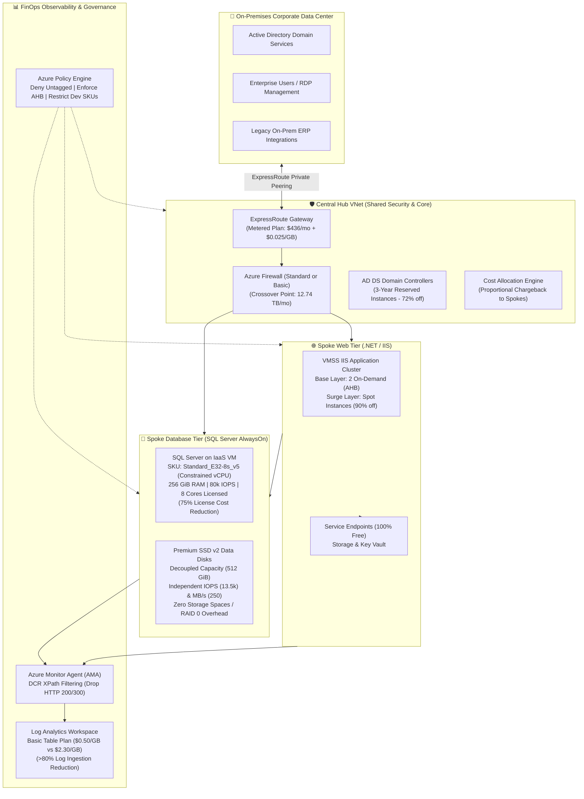

# Azure Hybrid IaaS FinOps Framework & Architecture Blueprint

[](https://github.com/nubenetes/azure-hybrid-iaas-finops-framework/actions/workflows/ci-lint-validate.yml)
[](https://www.finops.org/)
[-844FBA?logo=terraform)](https://www.terraform.io/)
[](https://learn.microsoft.com/azure/azure-resource-manager/bicep/)
[-3776AB?logo=python)](automation/python/)
[-5391FE?logo=powershell)](automation/powershell/)
[](LICENSE)

An enterprise-grade **FinOps architectural framework, decision engine, and Infrastructure-as-Code (IaC) blueprint** for optimizing hybrid Microsoft Azure IaaS environments (Windows Server, SQL Server on VMs, Hub-and-Spoke networking, ExpressRoute, and Azure Monitor).

This framework formalizes, expands, and implements the principles outlined in the technical monograph *"Informe Exhaustivo de Prácticas FinOps y Optimización de Costes para Arquitecturas Azure IaaS Híbridas"*, providing mathematical break-even models, dual-engine IaC (Terraform AzureRM v4 and native Bicep), automated Azure Policy guardrails, Azure Resource Graph (ARG) audit queries, Day-2 PowerShell runbooks, and an interactive FinOps calculator CLI.

> [!NOTE]
> **Architectural Reference Notice**
> 
> This repository and its accompanying IaC solutions serve as an **architecture reference blueprint and decision model**. All code, mathematical calculations, and configurations have passed static analysis, unit testing (`pytest`/`unittest`), Terraform v1.15+ validation, and Bicep compilation (`az bicep build`).
> Always validate and test in a non-production sandbox environment before applying permanent commitment discounts or automated deallocations.

---

## 📑 Table of Contents

- [1. 🏛️ Global Hybrid Architecture](#1-️-global-hybrid-architecture)
- [2. 💡 Financial Impact: Baseline vs. FinOps Optimized](#2--financial-impact-baseline-vs-finops-optimized)
- [3. 🧱 Core Architectural Pillars](#3--core-architectural-pillars)
  - [3.1. Visibility, Tagging & Coercive Governance](#31-visibility-tagging--coercive-governance)
  - [3.2. 3D Compute Optimization: Rightsizing, Lifecycle & Spot](#32-3d-compute-optimization-rightsizing-lifecycle--spot)
  - [3.3. Advanced Microsoft Licensing: AHB & Constrained vCPUs (CCC)](#33-advanced-microsoft-licensing-ahb--constrained-vcpus-ccc)
  - [3.4. Long-Term Financial Engineering: Commitment Portfolio](#34-long-term-financial-engineering-commitment-portfolio)
  - [3.5. Decoupled Storage Subsystem: Premium SSD v2](#35-decoupled-storage-subsystem-premium-ssd-v2)
  - [3.6. Hybrid Network Economics: ExpressRoute, Firewall & Endpoints](#36-hybrid-network-economics-expressroute-firewall--endpoints)
  - [3.7. Observability Cost Containment: AMA, DCR & Basic Table Plans](#37-observability-cost-containment-ama-dcr--basic-table-plans)
- [4. 📐 Mathematical Break-Even Models](#4--mathematical-break-even-models)
- [5. 📜 Architecture Decision Records (ADRs)](#5--architecture-decision-records-adrs)
- [6. 🔍 Azure Resource Graph (KQL) Audit Suite](#6--azure-resource-graph-kql-audit-suite)
- [7. 🧮 FinOps Interactive Calculator CLI](#7--finops-interactive-calculator-cli)
- [8. ⚙️ Day-2 Automation Runbooks](#8-️-day-2-automation-runbooks)
- [9. 🚀 Infrastructure as Code Quick Start](#9--infrastructure-as-code-quick-start)
- [10. 📂 Repository Structure](#10--repository-structure)
- [11. 📚 Works Cited & References](#11--works-cited--references)

---

## 1. 🏛️ Global Hybrid Architecture



---

## 2. 💡 Financial Impact: Baseline vs. FinOps Optimized

The table below illustrates a representative enterprise deployment (Hub-Spoke, 10 SQL Server database nodes, 30 IIS web server instances, ExpressRoute 1 Gbps, and centralized telemetry):

| Architecture Layer | Unoptimized Lift-and-Shift | FinOps Framework Optimized | Monthly Savings | Annual Savings |
| :--- | :--- | :--- | :--- | :--- |
| **SQL Server Licensing** | Unconstrained `E32s_v5` (32 cores) PAYG = **$128,105/mo** | Constrained `E32-8s_v5` (8 cores) + AHB = **$0/mo (SA) or $32,026/mo** | **-$96,079 / mo** | **$1,152,948 / yr** |
| **Windows Server OS** | Default PAYG licensing (~36% surcharge) = **$14,280/mo** | Azure Hybrid Benefit (AHB) enabled across all VMs = **$0/mo** | **-$14,280 / mo** | **$171,360 / yr** |
| **Database Storage** | Striped P40 disks on Premium v1 (40 TB) = **$5,530/mo** | Decoupled Premium SSD v2 (5 TB + 13.5k IOPS) = **$1,365/mo** | **-$4,165 / mo** | **$49,980 / yr** |
| **ExpressRoute Circuit** | 1 Gbps Unlimited Plan ($6,450 port flat) = **$6,450/mo** | 1 Gbps Metered Plan ($436 port + 8 TB egress) = **$636/mo** | **-$5,814 / mo** | **$69,768 / yr** |
| **Web Tier Compute** | Static 24/7 D-series PAYG VMs = **$9,850/mo** | VMSS Priority Mix (2 On-Demand Base + Spot Burst) = **$3,450/mo** | **-$6,400 / mo** | **$76,800 / yr** |
| **Telemetry & Logs** | Full unfiltered IIS W3C & Security logs = **$7,600/mo** | AMA + DCR XPath Edge filter + Basic Table Plan = **$1,520/mo** | **-$6,080 / mo** | **$72,960 / yr** |
| **PaaS Endpoint Traffic** | Private Endpoints on all internal subnets = **$1,250/mo** | VNet Service Endpoints (100% Free) = **$0/mo** | **-$1,250 / mo** | **$15,000 / yr** |
| **TOTAL TCO** | **$173,065 / month** | **$39,077 / month** | **-$133,988 / mo** | **$1,607,856 / yr** |

> 💰 **Bottom Line Impact**: Implementing this framework generates a **77.4% sustained reduction in monthly cloud expenditure**, eliminating over **$1.6 Million USD annually** in infrastructure waste.

---

## 3. 🧱 Core Architectural Pillars

### 3.1. Visibility, Tagging & Coercive Governance
- **Comprehensive Taxonomy**: Mandatory organizational dimensions (`CostCenter`, `Environment`, `Owner`, `Workload`, `SharedService`).
- **Coercive Azure Policy**: Deployments lacking required financial context are rejected at ARM compilation (`deny-resources-without-tags.json`). Child resources automatically inherit tags from parent resource groups (`inherit-tags-from-rg.json`).
- **Hub-Spoke Cost Allocation**: Implements Azure Cost Allocation Rules to distribute central firewall and gateway costs proportionally to consuming spokes based on empirical network and compute metrics.
- 📖 *Full Technical Guide*: [`docs/01-governance-tagging-cost-allocation.md`](docs/01-governance-tagging-cost-allocation.md)

### 3.2. 3D Compute Optimization: Rightsizing, Lifecycle & Spot
- **Empirical Rightsizing**: 30-day continuous telemetry focusing on P95 and P99 percentiles instead of averages.
- **VM Series Specialization**: B-series burstable for Dev/Test (minimum B2s for Windows Server); F/D-series for stateless .NET IIS; E-series and `Ebdsv5` NVMe for SQL Server.
- **The Deallocation Trap**: Eliminates the common mistake of shutting down VMs from the guest OS (`Stopped` state continues charging CPU/RAM at 100%). Enforces `Stopped (deallocated)` via Azure APIs ($0.00/hr compute).
- **VMSS Priority Mix**: Configures scale sets with a reliable on-demand floor and elastic Spot instances for up to 90% discount on web scaling tiers.
- 📖 *Full Technical Guide*: [`docs/02-compute-rightsizing-lifecycle-spot.md`](docs/02-compute-rightsizing-lifecycle-spot.md)

### 3.3. Advanced Microsoft Licensing: AHB & Constrained vCPUs (CCC)
- **Azure Hybrid Benefit (AHB)**: Amortizes existing Software Assurance investments to eliminate the Windows Server OS fee (~36% savings) and SQL Server engine fee (up to 85% combined savings).
- **180-Day Dual-Use Rights**: Enables parallel testing and live migration of on-premises licenses to Azure for 6 months with zero audit penalties.
- **SQL Server Developer Edition**: 100% feature parity with Enterprise at zero licensing cost in non-prod.
- **Constrained vCPUs (CCC)**: Deploys `Standard_E32-8s_v5` to satisfy 256 GiB RAM and 80,000 IOPS while masking 24 cores from the OS. SQL Server invoices only 8 cores, yielding an immediate 75% license reduction.
- 📖 *Full Technical Guide*: [`docs/03-licensing-ahb-constrained-vcpu.md`](docs/03-licensing-ahb-constrained-vcpu.md)

### 3.4. Long-Term Financial Engineering: Commitment Portfolio
- **The "Floor & Ceiling" Model**: Combines rigid 3-Year Reserved Instances (RIs) for 60-70% immutable baseline infrastructure with flexible Compute Savings Plans for elastic tiers, avoiding commitment lock-in while capturing up to 72% discounts.
- 📖 *Full Technical Guide*: [`docs/04-commitment-portfolio-ri-savings-plans.md`](docs/04-commitment-portfolio-ri-savings-plans.md)

### 3.5. Decoupled Storage Subsystem: Premium SSD v2
- **Abolishing the RAID 0 Anti-Pattern**: Replaces Windows Storage Spaces striped P30/P40 disks with single decoupled Premium SSD v2 disks.
- **Independent Sliders**: Adjust Capacity (GiB), IOPS, and Throughput (MB/s) independently. Every disk includes 3,000 IOPS and 125 MB/s free of charge.
- **Zero-Downtime Tuning**: Dynamic performance scaling up to 4 times per 24-hour period allows boosting IOPS before nightly backup windows and dialing down afterwards.
- 📖 *Full Technical Guide*: [`docs/05-storage-optimization-premium-ssdv2.md`](docs/05-storage-optimization-premium-ssdv2.md)

### 3.6. Hybrid Network Economics: ExpressRoute, Firewall & Endpoints
- **ExpressRoute Break-Even**: Proves mathematically that the Unlimited plan requires sustained >73% line saturation 24/7. Hybrid enterprises transferring <240 TB/mo save $5,800/mo by deploying Metered.
- **The Asymmetric Transition Trap**: Upgrading Metered to Unlimited is zero-downtime; downgrading Unlimited to Metered is blocked by Microsoft and requires circuit destruction. Always start Metered.
- **Azure Firewall Crossover**: Evaluates the 12.74 TB/month crossover between Basic ($0.065/GB processing) and Standard ($0.016/GB processing).
- **Service Endpoints vs. Private Endpoints**: Defaults to 100% free Service Endpoints for internal VNet-to-PaaS traffic, reserving Private Endpoints strictly for on-premises hybrid access.
- 📖 *Full Technical Guide*: [`docs/06-hybrid-network-expressroute-firewall-endpoints.md`](docs/06-hybrid-network-expressroute-firewall-endpoints.md)

### 3.7. Observability Cost Containment: AMA, DCR & Basic Table Plans
- **Edge XPath Filtering**: Azure Monitor Agent evaluates XPath filters inside the Windows kernel, discarding HTTP 200-399 and non-critical Event IDs before data crosses the network.
- **Log Analytics Basic Table Plan**: Reduces ingestion cost from ~$2.30/GB down to ~$0.50/GB (>78% savings) for high-volume network and firewall diagnostic logs.
- 📖 *Full Technical Guide*: [`docs/07-observability-ama-dcr-log-analytics.md`](docs/07-observability-ama-dcr-log-analytics.md)

---

## 4. 📐 Mathematical Break-Even Models

| Model | Core Formula | Key Finding / Threshold | Documentation |
| :--- | :--- | :--- | :--- |
| **ExpressRoute Break-Even** | $E_{\text{break-even}} = \frac{P_{\text{unlimited}} - P_{\text{metered}}}{C_{\text{egress}}}$ | 1 Gbps circuit break-even = **240.6 TB/month (73.2% 24/7 saturation)** | [`docs/math-models/expressroute-breakeven.md`](docs/math-models/expressroute-breakeven.md) |
| **Firewall SKU Crossover** | $V_{\text{crossover}} = \frac{\Delta \text{Fixed}}{\Delta \text{Processing Rate}}$ | Basic vs. Standard crossover = **12.74 TB/month** (250 Mbps throttle on Basic) | [`docs/math-models/firewall-sku-crossover.md`](docs/math-models/firewall-sku-crossover.md) |
| **SQL Server Constrained Cores**| $R_{\text{savings}} = \left(1 - \frac{N_{\text{active}}}{N_{\text{phys}}}\right) \times 100\%$ | `E32-8s_v5` yields **75% software licensing reduction** with full 256 GiB RAM | [`docs/math-models/sql-licensing-ccc-matrix.md`](docs/math-models/sql-licensing-ccc-matrix.md) |

---

## 5. 📜 Architecture Decision Records (ADRs)

Key architectural trade-offs are documented as immutable Architecture Decision Records:
- **[ADR-001](docs/adr/ADR-001-constrained-vcpu-for-sql-workloads.md)**: Adoption of Constrained vCPU VM Sizes for SQL Server IaaS Workloads.
- **[ADR-002](docs/adr/ADR-002-premium-ssd-v2-decoupled-storage.md)**: Migration from Premium SSD v1 to Premium SSD v2 for Transactional Storage.
- **[ADR-003](docs/adr/ADR-003-expressroute-metered-vs-unlimited.md)**: Default Selection of Metered Data Plan for Hybrid Azure ExpressRoute Circuits.
- **[ADR-004](docs/adr/ADR-004-service-endpoints-vs-private-endpoints.md)**: Standardizing on Service Endpoints vs. Private Endpoints for PaaS Traffic.
- **[ADR-005](docs/adr/ADR-005-ama-dcr-edge-log-filtering.md)**: Adoption of Azure Monitor Agent (AMA) with DCR Edge XPath Filtering.

---

## 6. 🔍 Azure Resource Graph (KQL) Audit Suite

A complete suite of KQL queries designed to run in Azure Resource Graph Explorer to detect cost leaks and licensing optimization candidates:

| Audit Target | KQL Query File | Detected Financial Leak |
| :--- | :--- | :--- |
| **Stopped (Non-Deallocated) VMs** | [`find-stopped-not-deallocated-vms.kql`](kql-queries/find-stopped-not-deallocated-vms.kql) | VMs stopped from guest OS still charging 100% CPU/RAM |
| **Orphaned Managed Disks** | [`find-orphaned-managed-disks.kql`](kql-queries/find-orphaned-managed-disks.kql) | Unattached OS/Data disks billing storage capacity |
| **Unassociated Public IPs** | [`find-unassociated-public-ips.kql`](kql-queries/find-unassociated-public-ips.kql) | Static public IPs incurring hourly idle reservation fees |
| **Missing Azure Hybrid Benefit** | [`find-vms-missing-hybrid-benefit.kql`](kql-queries/find-vms-missing-hybrid-benefit.kql) | Windows and SQL VMs paying full PAYG licensing rates |
| **SQL VMs for Constrained vCPUs**| [`find-sql-vms-eligible-for-constrained-vcpu.kql`](kql-queries/find-sql-vms-eligible-for-constrained-vcpu.kql) | High-core SQL VMs eligible for 50-75% licensing reduction |
| **Oversized Premium v1 Disks** | [`audit-premium-ssd-v1-to-v2-candidates.kql`](kql-queries/audit-premium-ssd-v1-to-v2-candidates.kql) | Oversized P30/P40 disks eligible for Premium SSD v2 migration |
| **Log Analytics Ingestion Spikes** | [`audit-log-analytics-ingestion-spikes.kql`](kql-queries/audit-log-analytics-ingestion-spikes.kql) | Tables generating excessive ingestion fees in workspace |

---

## 7. 🧮 FinOps Interactive Calculator CLI

A standalone Python command-line utility providing instant mathematical evaluations and TCO modeling:

```bash
# Compare ExpressRoute Metered vs. Unlimited for a 1 Gbps circuit with 5,000 GB egress:
python3 automation/python/finops_calculator.py expressroute --bandwidth 1000 --monthly-egress-gb 5000

# Output:
# =======================================================
#  AZURE FINOPS ENGINE: EXPRESSROUTE
# =======================================================
#  Bandwidth Mbps                : 1000
#  Monthly Egress Gb             : 5000.0
#  Cost Metered Usd              : 561.0
#  Cost Unlimited Usd            : 6450.0
#  Breakeven Egress Tb           : 234.92
#  Breakeven Saturation Pct      : 73.23
#  Recommendation                : Metered
#  Monthly Savings Usd           : 5889.0
# =======================================================
```

Other available commands:
- `python3 automation/python/finops_calculator.py firewall --monthly-gb 20000`
- `python3 automation/python/finops_calculator.py sql-licensing --physical-cores 32 --active-cores 8 --windows-ahb --ri-years 3`
- `python3 automation/python/finops_calculator.py storage --capacity-gb 1024 --iops 12000 --throughput 250`

---

## 8. ⚙️ Day-2 Automation Runbooks

Production-grade PowerShell runbooks for Azure Automation or scheduled tasks:
- **[`Start-Stop-Deallocate-VMs.ps1`](automation/powershell/Start-Stop-Deallocate-VMs.ps1)**: Automatically deallocates non-prod and tagged VMs outside business hours.
- **[`Optimize-PremiumSSDv2-IOPS.ps1`](automation/powershell/Optimize-PremiumSSDv2-IOPS.ps1)**: Dynamically scales Premium SSD v2 IOPS and throughput with **zero downtime** before nightly database backups and dials them down before morning traffic.
- **[`Deconstruct-AzureFirewall-NonProd.ps1`](automation/powershell/Deconstruct-AzureFirewall-NonProd.ps1)**: Suspends non-production Azure Firewall instances outside office hours, eliminating the $912/month base fee.

---

## 9. 🚀 Infrastructure as Code Quick Start

### Terraform / OpenTofu (AzureRM v4)

```bash
cd terraform

# Initialize providers and modules
terraform init

# Validate configuration
terraform validate

# Review FinOps optimized execution plan
terraform plan -var="location=westeurope" -var="environment=prod"

# Deploy reference architecture
terraform apply -auto-approve
```

### Azure Bicep

```bash
cd bicep

# Compile and validate Bicep template
az bicep build --file main.bicep

# Deploy using Azure CLI
az deployment group create \
  --resource-group rg-finops-core-prod \
  --template-file main.bicep \
  --parameters @main.bicepparam
```

---

## 10. 📂 Repository Structure

```text
.
├── .github/
│   └── workflows/
│       └── ci-lint-validate.yml          # GitHub Actions CI for Terraform, Bicep, Python & Shell
├── automation/
│   ├── powershell/
│   │   ├── Deconstruct-AzureFirewall-NonProd.ps1
│   │   ├── Optimize-PremiumSSDv2-IOPS.ps1
│   │   └── Start-Stop-Deallocate-VMs.ps1
│   └── python/
│       ├── finops_calculator.py          # Interactive CLI financial calculator
│       ├── requirements.txt
│       └── test_finops_calculator.py     # Unit test suite verifying mathematical models
├── bicep/
│   ├── main.bicep                        # Native Azure Bicep root deployment
│   ├── main.bicepparam
│   └── modules/
│       ├── azurePolicy.bicep
│       ├── dcrRules.bicep
│       ├── hubNetwork.bicep
│       ├── spokeDb.bicep
│       └── spokeWeb.bicep
├── docs/
│   ├── 01-governance-tagging-cost-allocation.md
│   ├── 02-compute-rightsizing-lifecycle-spot.md
│   ├── 03-licensing-ahb-constrained-vcpu.md
│   ├── 04-commitment-portfolio-ri-savings-plans.md
│   ├── 05-storage-optimization-premium-ssdv2.md
│   ├── 06-hybrid-network-expressroute-firewall-endpoints.md
│   ├── 07-observability-ama-dcr-log-analytics.md
│   ├── 08-anti-patterns-and-gotchas.md
│   ├── adr/                              # Architecture Decision Records
│   │   ├── ADR-001-constrained-vcpu-for-sql-workloads.md
│   │   ├── ADR-002-premium-ssd-v2-decoupled-storage.md
│   │   ├── ADR-003-expressroute-metered-vs-unlimited.md
│   │   ├── ADR-004-service-endpoints-vs-private-endpoints.md
│   │   └── ADR-005-ama-dcr-edge-log-filtering.md
│   └── math-models/                      # Mathematical Break-Even Formulations
│       ├── expressroute-breakeven.md
│       ├── firewall-sku-crossover.md
│       └── sql-licensing-ccc-matrix.md
├── kql-queries/                          # Azure Resource Graph (ARG) FinOps Audit Suite
│   ├── audit-log-analytics-ingestion-spikes.kql
│   ├── audit-premium-ssd-v1-to-v2-candidates.kql
│   ├── find-orphaned-managed-disks.kql
│   ├── find-sql-vms-eligible-for-constrained-vcpu.kql
│   ├── find-stopped-not-deallocated-vms.kql
│   ├── find-unassociated-public-ips.kql
│   └── find-vms-missing-hybrid-benefit.kql
├── policies/                             # Azure Policy Definitions (JSON)
│   ├── enforce-azure-hybrid-benefit.json
│   ├── enforce-mandatory-tags.json
│   ├── enforce-premium-ssd-v2-production.json
│   ├── inherit-tags-from-rg.json
│   └── restrict-vm-skus-dev.json
├── scripts/
│   └── validate-all.sh                   # Comprehensive local pre-commit validation harness
├── terraform/
│   ├── main.tf                           # Root Terraform orchestrator
│   ├── outputs.tf
│   ├── terraform.tfvars.example
│   ├── variables.tf
│   ├── versions.tf                       # AzureRM v4 provider configuration
│   └── modules/
│       ├── governance_policy/
│       ├── hub_network/
│       ├── observability_dcr/
│       ├── spoke_db/
│       └── spoke_web/
├── azure-pipelines.yml                   # Azure DevOps Pipeline
├── bitbucket-pipelines.yml               # Bitbucket Pipelines
├── .gitlab-ci.yml                        # GitLab CI Pipeline
├── CONTRIBUTING.md
├── LICENSE                               # Apache 2.0
└── README.md                             # This documentation
```

---

## 11. 📚 Works Cited & References

1. CloudZero (2026). *Azure Cost Optimization: The Complete Guide*.
2. nOps (2026). *Azure Cost Optimization: Complete Guide*.
3. Another DevOps Blog (2026). *Mastering Cost Allocation in Azure*.
4. Microsoft Learn (2026). *Azure Managed Disk Types & Premium SSD v2 Specifications*.
5. Microsoft Learn (2026). *Data Collection Rules (DCRs) and Azure Monitor Agent (AMA)*.
6. Matías, C. (2026). *Azure Cost Optimization Guide: Practical Strategies That Actually Work*.
7. Inventive HQ (2026). *Azure Cost Allocation with Tags & Shared Resources*.
8. Microsoft Learn (2026). *Best Practices for Virtual Machine Cost Optimization*.
9. VBeyond Digital (2026). *Fix Shared Chargeback Disputes in Azure Cost Management*.
10. Microsoft Learn (2026). *Create and Manage Azure Cost Allocation Rules*.
11. Sedai (2026). *Top 20 Azure Cost Optimization Strategies for 2026*.
12. Intercept (2026). *Unlocking Azure SQL Pricing: Software Assurance & Hybrid Benefit*.
13. Microsoft Learn (2026). *Checklist & Best Practices for SQL Server on Azure Virtual Machines*.
14. Microsoft Learn (2026). *Constrained vCPU Sizes & Core Customization (CCC)*.
15. EgressCost (2026). *Azure Bandwidth & Egress Pricing Explained*.
16. Enforza (2026). *Azure Firewall Pricing: Fixed vs Variable Cost Optimization*.
17. FastTrack for Azure (2026). *Azure Private Endpoints vs. Service Endpoints: Architectural Guide*.
18. FinOps Foundation (2026). *FinOps for Azure Managed Disks: Optimizing for Value*.

---

## 📜 License

This project is licensed under the **Apache License 2.0**. See the [LICENSE](LICENSE) file for details.
