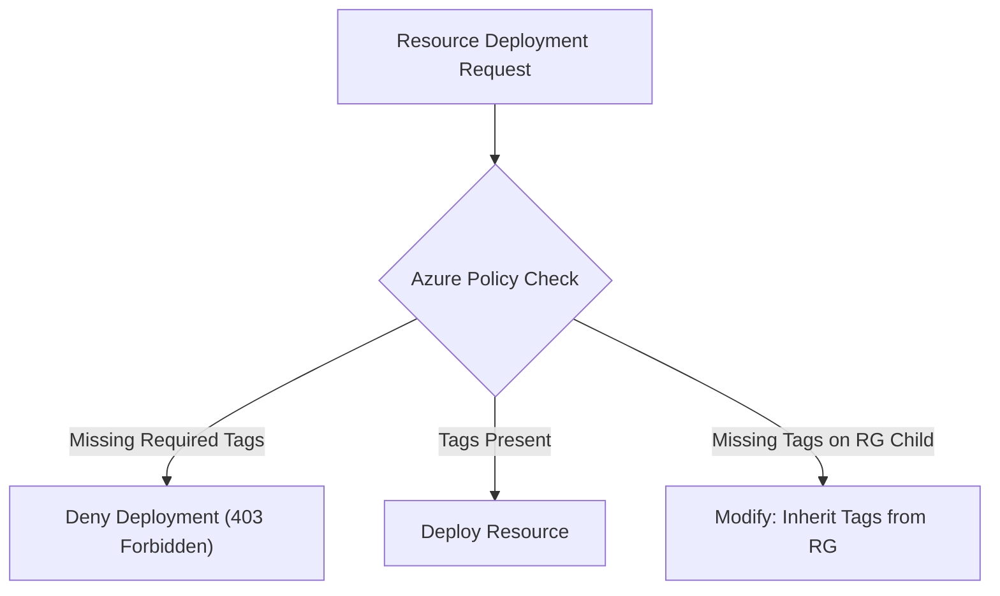

# 01. Visibility, Tagging Taxonomy, and Coercive Governance

> 🧭 **Navigation**: [🏠 Framework Root](../README.md) | [📚 Documentation Index](README.md) | [➡️ Next: 02. Compute Rightsizing](02-compute-rightsizing-lifecycle-spot.md)

> 📽️ **Video Sessions**:
> - 📽️ [**Azure Governance & Policy FinOps: Coercive Guardrails, Tagging & Cost Allocation**](https://www.youtube.com/watch?v=ewLnUSh-fJU) (`8:13`, 🇬🇧 English CC 20+) — *Technical deep dive into continuous policy enforcement, ARM deny effects, tag inheritance, and shared cost allocation.*
> - 📽️ [**FinOps Azure Híbrido: Gobernanza Coercitiva, Políticas y Automatización**](https://www.youtube.com/watch?v=yAm1-z2ZpfA) (`6:42`, 🇪🇸 Spanish CC 20+) — *Sesión técnica sobre gobernanza continua, políticas Azure Policy, reparto de costes y auditoría con KQL.*
> - ⚡ [**Turning Azure FinOps Theory into Automated Action**](https://www.youtube.com/shorts/09oqxYUeHd8) (`1:19`, 🇬🇧 English CC 20+) — *Píldora rápida sobre la cadena de automatización continua: Bicep, ARG y runbooks Day-2.*

## 1. The FinOps Axiom: You Cannot Optimize What You Cannot See

In structural Infrastructure-as-a-Service (IaaS) deployments, cloud sprawl is accelerated by self-service provisioning. Without proactive controls, resources accumulate across subscriptions with ambiguous ownership and zero financial attribution.
Standard Azure billing invoices aggregate consumption by resource group or subscription, completely failing to contextualize expenditures by business capability, product line, or technical owner.

---

## 2. Standardized Tagging Taxonomy

A resilient FinOps tagging strategy requires a strict schema enforced across all cloud assets. In hybrid IaaS, every resource must carry both **financial metadata** and **operational metadata**:

| Tag Key | Format / Type | Purpose | Example Value |
| :--- | :--- | :--- | :--- |
| `CostCenter` | String (Alpha-numeric code) | General Ledger accounting mapping | `CC-FIN-4010` |
| `Department` | Enum string | Organizational entity bearing cost | `Finance`, `Logistics`, `Platform` |
| `BusinessUnit`| Enum string | Division within the enterprise | `Retail-EMEA`, `B2B-Operations` |
| `Environment` | Enum string | Lifecycle stage | `Prod`, `Staging`, `Test`, `Dev` |
| `Owner` | String (Email/UPN) | Accountable engineering contact | `devops-team@company.com` |
| `Workload` | String | Application or service name | `ERP-Navision`, `IIS-CustomerPortal`|
| `Criticality` | Enum string | Disaster recovery tier | `Tier-1-MissionCritical`, `Tier-3` |
| `SharedService`| Boolean (`true`/`false`)| Determines hub cost allocation split | `true` (for Hub VNet), `false` |
| `AutoShutdown` | Boolean / String | Defines automated deallocation policy| `true`, `Mon-Fri-19:00-07:00` |

---

## 3. Coercive Governance via Azure Policy

Relying on manual tag entry during portal deployments or CI/CD runs inevitably leads to tagging omissions. When a resource is created without a `CostCenter` tag, its consumption for that billing period cannot be accurately attributed retrospectively in Azure Cost Management.

### 3.1 Enforcement Modes

1. **Deny Effect (`enforce-mandatory-tags.json`)**:
   Blocks any deployment (ARM, Bicep, Terraform, or Portal) if mandatory tags (`CostCenter`, `Environment`, `Owner`) are not explicitly defined in the payload.
2. **Modify Effect (`inherit-tags-from-rg.json`)**:
   Automatically cascades tags applied at the Resource Group level down to child resources (NICs, Disks, Public IPs) upon creation or remediation tasks.

---

## 4. Cost Allocation in Hub-and-Spoke Topologies

The central **Hub VNet** hosts shared perimeter security and connectivity assets:
- Azure Firewall
- ExpressRoute / VPN Gateways
- Active Directory Domain Services (AD DS) replica domain controllers

Assigning the entire Hub bill directly to the platform or cybersecurity team distorts the true Total Cost of Ownership (TCO) of business applications. Application spokes consume hub connectivity and protection, and must absorb their fair share.

### 4.1 Azure Cost Allocation Methodologies

Azure Cost Management provides **Cost Allocation Rules** that operate within the analytical reporting layer (without altering official Microsoft Customer Agreement invoices):

1. **Fixed Percentage (Custom Split)**:
   - *Mechanism*: Manually assigns fixed percentages based on organizational agreement (e.g. 50% Retail Spoke, 30% Logistics Spoke, 20% Corporate Spoke).
   - *Use Case*: Organizations early in their FinOps maturity where network telemetry measurement is not yet fully automated.
2. **Even Split (Equal Distribution)**:
   - *Mechanism*: Divides the Hub resource group costs equally across all active spoke subscriptions.
   - *Use Case*: Homogeneous development environments and standardized microservice spokes.
3. **Proportional Split (Compute / Bandwidth Driven)**:
   - *Mechanism*: Hub costs are redistributed dynamically based on each spoke's actual compute footprint (vCPU hours) or network data volume routed through the hub firewall.
   - *Use Case*: Mature FinOps environments where spokes driving high data transfer take proportional responsibility for Azure Firewall and Gateway costs.

---

## 5. Daily Parquet Exports & FinOps Hubs Integration

To detect anomalies, forecast trends, and cross-reference cloud spending with ERP ledgers:
- Configure daily automated cost and usage exports (**FOCUS format or standard Amortized Cost**) in **Apache Parquet format**.
- Target exports to an **Azure Data Lake Storage Gen2 (ADLS Gen2)** container.
- Connect ADLS Gen2 directly to **Microsoft Fabric / Azure Synapse** or **Power BI** for automated executive showback and chargeback reporting.

---

## 🧭 Navigation & Reading Path

| [🏠 Framework Root](../README.md) | [📚 Documentation Index](README.md) | [➡️ Next: 02. Compute Rightsizing](02-compute-rightsizing-lifecycle-spot.md) |
| :--- | :---: | ---: |
| [🏠 Return to Framework Root](../README.md) | **[Interactive Docs Directory](README.md)** | [Next Thematic Module ➡️](02-compute-rightsizing-lifecycle-spot.md) |

