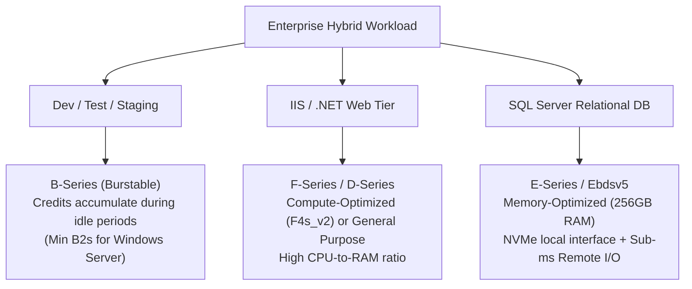
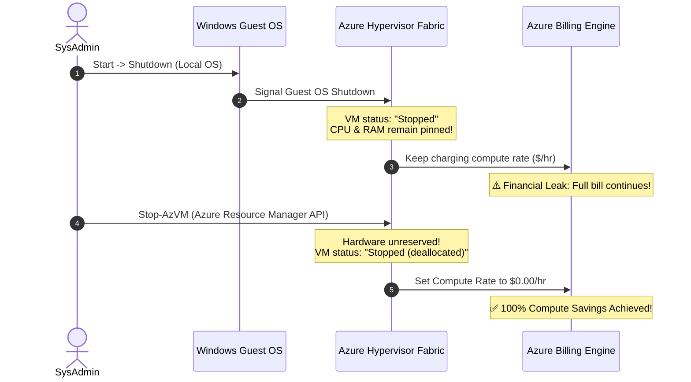

# 02. Compute Layer Optimization: Rightsizing, Lifecycle Management & Spot Elasticity

> 🧭 **Navigation**: [🏠 Framework Root](../README.md) | [📚 Documentation Index](README.md) | [⬅️ Previous: 01. Governance & Tagging](01-governance-tagging-cost-allocation.md) | [➡️ Next: 03. Advanced Licensing](03-licensing-ahb-constrained-vcpu.md)

> 📽️ **Video Sessions**:
> - 📽️ [**Azure FinOps: 3D Compute Engineering, Rightsizing & VM Lifecycle Automation**](https://www.youtube.com/watch?v=jt7t1BPNBsY) (`7:22`) — *Technical masterclass on empirical P95/P99 rightsizing, specialized VM families, and automated hypervisor deallocation.*
> - ⚡ [**The Azure Cloud VM Shutdown Trap: Stopped vs Deallocated**](https://www.youtube.com/shorts/G49JolO2L2I) (`1:13`) — *Píldora rápida sobre la trampa del apagado en SO vs desasignación por API.*

## 1. The Lift-and-Shift Fallacy

The most common antipattern in cloud migrations is 1:1 hardware mapping: translating an on-premises physical server with 16 cores and 64 GB RAM directly into an equivalent Azure VM SKU without empirical analysis. On-premises servers were historically overprovisioned to accommodate 3-year capacity growth. Replicating this headroom in the cloud introduces 50-70% permanent financial waste.

---

## 2. Empirical Rightsizing Framework

Decisions to resize or alter VM families must not rely on single peak events or simple averages. They must be grounded in continuous metric telemetry:
- **Observation Window**: Minimum of 30 contiguous days to capture month-end batch cycles, payroll runs, and quarterly workloads.
- **Key Percentiles**:
  - Focus on **P95 and P99 percentiles** for CPU, Memory, Disk IOPS, and Network Throughput.
  - If a VM's P95 CPU is under 20% and P99 is under 35%, it is an immediate candidate for downsizing.
- **Azure Advisor Heuristics**: Azure Advisor uses conservative threshold algorithms (typically flagging VMs with CPU <= 5% over 7 days). FinOps teams should implement custom Azure Resource Graph (ARG) queries for aggressive rightsizing candidates.

---

## 3. VM Series Alignment by Workload Tier

Selecting the appropriate VM family is the foundation of compute cost efficiency:

### 3.1 Non-Production / Dev-Test: B-Series (Burstable)
- B-series VMs accumulate CPU credits while operating below baseline performance.
- When compilation or service initialization occurs, credits are spent to burst up to 100% CPU.
- **Critical Windows Server Tip**: Always provision at least a **B2s or B2ms size** for Windows Server. B1s instances (1 vCPU, 1 GiB RAM) suffer OS thrashing, memory exhaustion during Windows Defender updates, and frequent RDP disconnection.

### 3.2 Stateless Web / Application Tier (.NET / IIS): F-Series & D-Series
- Monolithic and N-tier .NET applications hosted on Internet Information Services (IIS) are predominantly CPU-bound and network throughput-bound.
- F-series (Compute-optimized, e.g. `F4s_v2`, `F8s_v2`) offer a high CPU-to-memory ratio at a low hourly rate.
- D-series (e.g. `D4ds_v5`) provides balanced memory-to-core ratios for workloads requiring in-memory session caches.

### 3.3 Relational Database Tier: E-Series & Specialized Ebdsv5 / Ebsv5
- SQL Server requires massive memory for its buffer cache and extensive disk bandwidth for transactional consistency.
- The `Ebdsv5` and `Ebsv5` VM families provide up to **4,000 MB/s remote disk throughput** and **260,000 IOPS**, allowing databases to achieve extreme storage performance without paying for astronomical VM sizes.

---

## 4. Lifecycle Management: The Deallocation Trap

One of the largest hidden compute leaks occurs when operations teams shut down virtual machines from inside the operating system.

| Action | Hypervisor State | CPU & RAM Allocation | Compute Billing Status | Storage / IP Billing |
| :--- | :--- | :--- | :--- | :--- |
| **Windows Guest OS Shutdown** (`shutdown /s`) | `Stopped` | **Preserved on host silicon** | **100% BILLED (Full Hourly Rate)** | Disks & Static IPs Billed |
| **Azure Portal / API Deallocation** (`Stop-AzVM`) | `Deallocated` | **Released back to Azure pool** | **$0.00 / hr (COMPUTE CHARGES CEASE)**| Disks & Static IPs Billed |

> [!WARNING]
> **Ghost Infrastructure**: Even when deallocated, attached Managed Disks (OS and Data) and unassociated static Public IPs continue generating charges until explicitly deleted.

---

## 5. Elasticity via Spot VMs & VMSS Priority Mix

For fault-tolerant, asynchronous, or queue-driven workloads (.NET background workers processing Service Bus messages, batch rendering, nightly reporting):
- **Azure Spot VMs** offer up to **90% discount** compared to pay-as-you-go.
- The platform can evict Spot VMs with a 30-second warning via the **Scheduled Events API**.

### 5.1 VMSS Priority Mix Policy (`priorityMixPolicy`)
To achieve high availability with Spot economics on IIS web farms:
- Configure a **Virtual Machine Scale Set (VMSS)** with a **Priority Mix Policy**.
- Set a **Base Layer** of on-demand or Reserved Instances (e.g., 2 dedicated instances) to guarantee 100% baseline uptime for HTTP traffic.
- Configure all scaling surge instances (from 3 up to 20 instances) to be filled by **Spot instances**, absorbing temporary spikes at a 90% discount.

---

## 🧭 Navigation & Reading Path

| [⬅️ Previous: 01. Governance & Tagging](01-governance-tagging-cost-allocation.md) | [📚 Documentation Index](README.md) | [➡️ Next: 03. Advanced Licensing](03-licensing-ahb-constrained-vcpu.md) |
| :--- | :---: | ---: |
| [🏠 Return to Framework Root](../README.md) | **[Interactive Docs Directory](README.md)** | [Next Thematic Module ➡️](03-licensing-ahb-constrained-vcpu.md) |

