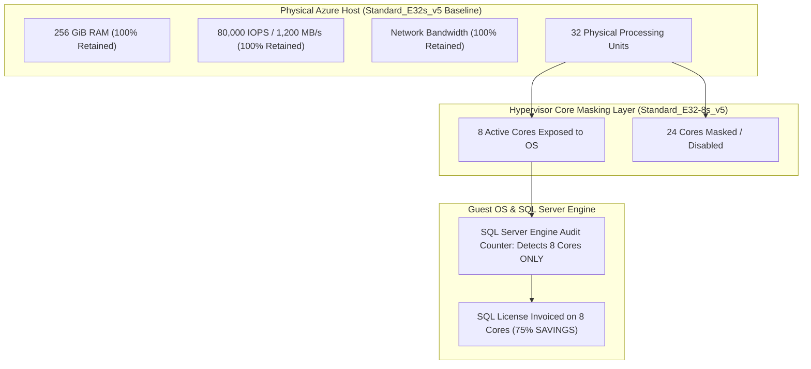

# 03. Advanced Microsoft Licensing: AHB, Dual-Use Rights & Constrained vCPUs

## 1. The Cost Weight of Software Intellectual Property

In Microsoft enterprise IaaS architectures, the cost of software licenses—specifically **Windows Server** and **SQL Server**—frequently dwarfs the cost of the underlying virtualized hardware:
- For a standard compute VM, Windows Server licensing adds a **~36% surcharge** over an equivalent Linux instance.
- For a SQL Server Enterprise instance on a 32-core VM, the SQL license costs over **$12,800/month**, compared to ~$1,800/month for the compute hardware.

Strategic management of cloud licensing rules represents the most impactful lever in an enterprise FinOps program.

---

## 2. Azure Hybrid Benefit (AHB) Mechanics

Azure Hybrid Benefit allows organizations with active **Software Assurance (SA)** on their on-premises Windows Server and SQL Server core licenses to bring those licenses to Azure:

### 2.1 Windows Server AHB
- Eliminates the Windows OS surcharge on Azure VMs.
- VM pricing drops to the base Linux compute rate.
- Rules: Requires a minimum of 8 core licenses per VM, and minimum 16 core licenses per customer agreement.
- Applicable to both standard VMs and Virtual Machine Scale Sets (VMSS).

### 2.2 SQL Server AHB
- Eliminates the SQL Server software hourly rate completely.
- When combined with 3-Year Reserved Instances (RIs), SQL Server VM costs contract by up to **85%**.
- 1 core of SQL Server Enterprise with SA covers 1 vCPU of Azure SQL VM (or 4 vCPUs of Azure SQL Managed Instance General Purpose).

---

## 3. The 180-Day Dual-Use Rights Window

A major deterrent to enterprise cloud migration is the fear of paying double licensing during the migration and cutover period.
Microsoft licensing agreements explicitly grant **Dual-Use Rights**:
- For a period of **180 continuous days**, the same on-premises Windows Server and SQL Server licenses can simultaneously run on the on-premise hardware and in Azure VMs.
- Enables exhaustive end-to-end integration testing, database synchronization (via AlwaysOn Availability Groups or Log Shipping), and staged user cut-over with zero risk of Microsoft licensing audit fines or double-invoicing.

---

## 4. SQL Server Developer Edition for Non-Production

Running licensed commercial editions (Standard or Enterprise) in development, QA, or staging environments is a severe FinOps antipattern:
- **SQL Server Developer Edition** provides 100% feature parity with SQL Server Enterprise.
- Includes advanced features: AlwaysOn Availability Groups, Online Index Rebuilding, Transparent Data Encryption (TDE), Partitioning.
- **Cost**: 100% free of SQL Server licensing surcharges. Only the base compute and Windows OS are billed.

---

## 5. Constrained vCPUs & Configurable Constrained Cores (CCC)

### 5.1 The SQL Server Licensing Paradox

Enterprise ERP systems, accounting software, and high-transaction databases require vast amounts of RAM (128 GiB to 512 GiB) to cache active data pages, alongside high disk bandwidth (80,000 IOPS).
In Azure, a VM providing 256 GiB RAM is the `Standard_E32s_v5`, which features **32 vCPUs**.
Because SQL Server is licensed per active vCPU, an enterprise would be forced to purchase 32 core licenses—costing **$12,810/month** in PAYG SQL Enterprise licensing, even if their query concurrency only requires 8 cores!

### 5.2 The Hypervisor Solution: Constrained Cores

To eliminate this artificial penalty, Microsoft introduced **Constrained vCPU sizes**:
- Example SKU: `Standard_E32-8s_v5` or `Standard_E32-16s_v5`.
- **Underlying Physical Machine**: The VM runs on the full 32-core host, retaining all **256 GiB of RAM**, full **80,000 IOPS**, and full network bandwidth.
- **Hypervisor Core Masking**: The Azure hypervisor masks 24 cores from the guest OS, presenting only **8 active vCPUs** to Windows and SQL Server.
- **Financial Result**: SQL Server software licensing drops from 32 cores down to 8 cores—an immediate **75% reduction in licensing fees** ($9,600/month saved per database VM).

### 5.3 NUMA Affinity & Latency Elimination
High-core VMs often span multiple virtual NUMA nodes. When SQL Server threads cross NUMA boundaries, memory access latency spikes and scheduler thread contention occurs. Restricting active cores to 8 or 16 within a single NUMA boundary eliminates thread contention warnings and optimizes cache locality.
