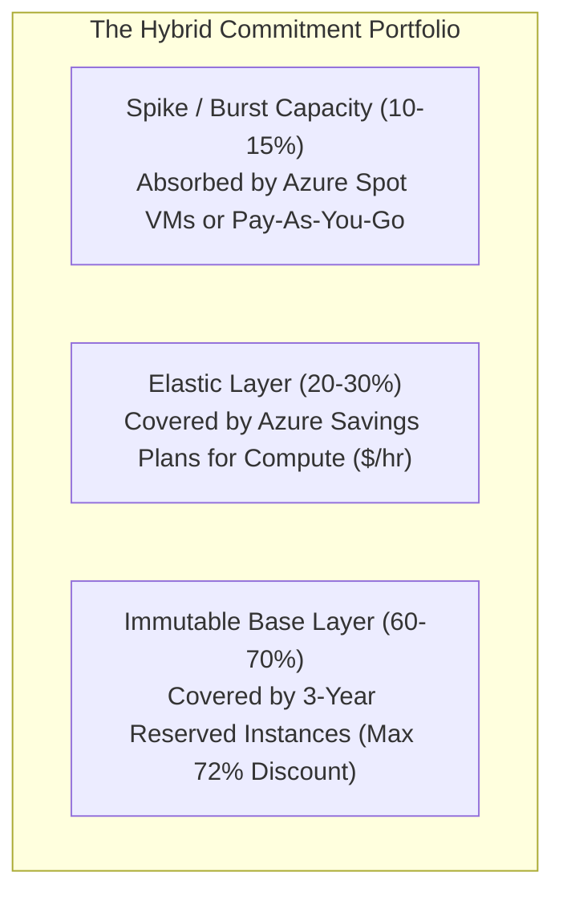

# 04. Long-Term Financial Engineering: The Hybrid Commitment Portfolio

> 🧭 **Navigation**: [🏠 Framework Root](../README.md) | [📚 Documentation Index](README.md) | [⬅️ Previous: 03. Advanced Licensing](03-licensing-ahb-constrained-vcpu.md) | [➡️ Next: 05. Decoupled Storage](05-storage-optimization-premium-ssdv2.md)

## 1. Beyond Architectural Rightsizing

While architectural rightsizing directly alters infrastructure configurations, commitment discounts are purely **financial instruments**. They secure steep price reductions in exchange for contractual usage commitments over 1-year or 3-year horizons.

In Azure, FinOps practitioners have two complementary commitment instruments:
1. **Reserved Virtual Machine Instances (RIs)**
2. **Azure Savings Plans for Compute**

---

## 2. Reserved Instances (RIs) vs. Savings Plans

| Dimension | Reserved Instances (RIs) | Azure Savings Plans for Compute |
| :--- | :--- | :--- |
| **Commitment Type** | Specific VM series/size in a specific Azure region | Sustained hourly spend ($/hour across compute) |
| **Maximum Discount** | Up to **72%** (3-year) | Up to **65%** (3-year) |
| **Flexibility** | Rigid: Tied to specific VM family and region | High: Automatically applies across VM families, regions, OS, and compute types |
| **Applicable Services**| Virtual Machines, Azure Dedicated Hosts | VMs, VMSS, Container Apps, App Service, Functions |
| **Optimal FinOps Use** | Immutable, 24/7 baseline infrastructure | Elastic tiers, dynamic web farms, multi-region workloads |

---

## 3. The "Hybrid Commitment Portfolio" Model

The most effective FinOps strategy for hybrid IaaS avoids relying exclusively on either RIs or Savings Plans. Instead, it constructs a **tiered commitment structure**:

### 3.1 Tier 1: The Immutable Floor (3-Year RIs)
- Target: Infrastructure that runs 24/7/365 and will never be decommissioned or switched to another family within 3 years.
- Workloads: SQL Server AlwaysOn primary and secondary replicas, Active Directory Domain Controllers in the Hub VNet, core network virtual appliances.
- Impact: Secures the maximum available discount (~72%).

### 3.2 Tier 2: The Elastic Ceiling (1-Year or 3-Year Savings Plans)
- Target: Dynamic, fluctuating, or evolving workloads.
- Workloads: IIS Web VMSS clusters that auto-scale between daytime peak and nighttime quiet periods, staging environments, workloads slated for potential modernization.
- Impact: Provides substantial discounts (~65%) while allowing seamless transitions across instance generations (e.g. from v4 to v5/v6) without commitment breakage.

### 3.3 Tier 3: Elastic Surge & Burst (Spot & On-Demand)
- Target: Temporary compute spikes exceeding the commitment threshold.
- Absorbed by Spot instances (up to 90% discount) or pure Pay-As-You-Go.

---

## 4. Commitment Governance & Drift Prevention

To prevent underutilization and commitment waste:
1. **Scoping**: Purchase commitments at the **Shared (Billing Account / Management Group)** scope whenever possible, rather than locking them to a single subscription or resource group.
2. **KQL Audit Queries**: Schedule weekly Azure Resource Graph queries to calculate the **Commitment Coverage Ratio** and **Commitment Utilization Ratio**.
3. **Threshold Guardrails**: Target an overall coverage ratio between **80% and 85%**. Exceeding 90% coverage risks incurring waste if workloads are migrated or optimized.

---

## 🧭 Navigation & Reading Path

| [⬅️ Previous: 03. Advanced Licensing](03-licensing-ahb-constrained-vcpu.md) | [📚 Documentation Index](README.md) | [➡️ Next: 05. Decoupled Storage](05-storage-optimization-premium-ssdv2.md) |
| :--- | :---: | ---: |
| [🏠 Return to Framework Root](../README.md) | **[Interactive Docs Directory](README.md)** | [Next Thematic Module ➡️](05-storage-optimization-premium-ssdv2.md) |

