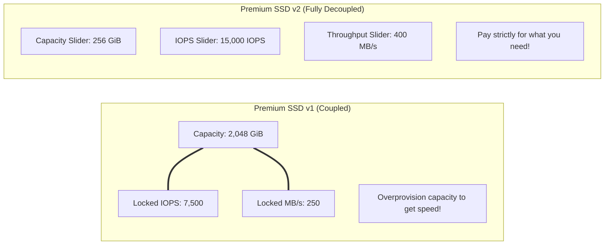

# 05. Transactional Storage Optimization: Premium SSD v2 & Decoupled I/O

> 🧭 **Navigation**: [🏠 Framework Root](../README.md) | [📚 Documentation Index](README.md) | [⬅️ Previous: 04. Commitment Engineering](04-commitment-portfolio-ri-savings-plans.md) | [➡️ Next: 06. Hybrid Networking](06-hybrid-network-expressroute-firewall-endpoints.md)

> 📽️ **Video Sessions**:
> - 📽️ [**Azure Storage: Decouple Capacity & IOPS with Premium SSD v2 in FinOps**](https://www.youtube.com/watch?v=BZsmqa_FUGk) (`8:43`, 🇬🇧 English CC 20+) — *Technical breakdown on decoupling storage capacity, IOPS, and throughput, eliminating legacy RAID 0 striping, and pairing with NVMe Ebdsv5 VMs.*
> - 📽️ [**Almacenamiento FinOps en Azure: Premium SSD v2 y Fin del Desperdicio en Discos**](https://www.youtube.com/watch?v=vxBSeN1c3os) (`6:14`, 🇪🇸 Spanish CC 20+) — *Masterclass sobre desacoplamiento de discos, erradicación de RAID 0 en Storage Spaces y emparejamiento con instancias NVMe Ebdsv5.*
> - ⚡ [**How Azure Premium SSD v2 Decouples Storage**](https://www.youtube.com/shorts/FseN2K1O9PU) (`1:08`, 🇬🇧 English CC 20+) — *Píldora rápida de 1 minuto resumiendo los controles independientes de Capacidad, IOPS y MB/s.*

## 1. Storage as the Primary SQL Server Bottleneck

In transactional database systems (SQL Server on Azure VMs), disk storage performance is critical:
- **Transaction Log (`ldf`)**: Requires strict, sequential write guarantees with sub-millisecond commit latency. Slow log flushes cause `WRITELOG` wait states, freezing application transactions.
- **TempDB**: Requires high parallel IOPS and throughput to prevent pagination and spill-to-disk contention during complex joins and index maintenance.
- **Data Files (`mdf`/`ndf`)**: Require low-latency read operations for pages not yet cached in the buffer pool.

---

## 2. The Premium SSD v1 Antipattern: Forced Overprovisioning

Under Azure **Premium SSD v1**, performance metrics (IOPS and MB/s throughput) were strictly coupled to provisioned storage capacity:
- A **P10** disk (128 GiB) yielded only **500 IOPS** and **100 MB/s**.
- To achieve **7,500 IOPS**, architects had to provision a **P40** disk (2,048 GiB), paying for 2 TiB even if the database only held 100 GiB of data.

### 2.1 The Software RAID 0 (Storage Spaces) Penalty
To achieve 15,000 to 20,000 IOPS, engineers were forced to create **Windows Server Storage Spaces** across multiple striped P30/P40 disks:
- **Financial Disaster**: Paying for tens of terabytes of empty, unused disk space purely to aggregate IOPS. Over 70-80% of storage spend was wasted.
- **Operational Complexity**: Software striping inside the guest OS increased CPU utilization for parity/splitting calculations.
- **Backup Fragility**: Volume-consistent snapshots across multiple striped disks complicated disaster recovery and prolonged restore operations.

---

## 3. The Premium SSD v2 Architecture

**Premium SSD v2** revolutionizes Azure managed disks by completely decoupling the three performance dimensions:
1. **Storage Capacity (GiB)**
2. **IOPS**
3. **Throughput (MB/s)**

### 3.1 Baseline Included Performance (Free Tier)
Every Premium SSD v2 disk provisioned, regardless of capacity (whether 50 GiB or 32 TiB), includes:
- **3,000 IOPS baseline at $0.00 extra cost**.
- **125 MB/s baseline throughput at $0.00 extra cost**.
- Additional IOPS and throughput are billed independently on an hourly consumption basis.

### 3.2 Dynamic Online Performance Tuning (Zero Downtime)
- Premium SSD v2 parameters can be dynamically scaled up or down **up to 4 times within a rolling 24-hour period**.
- Adjustments take effect in seconds **without restarting the VM or unmounting the filesystem**.
- Enables automated Day-2 runbooks to boost IOPS before nightly ETL/backup windows and scale them back down before morning traffic arrives.

---

## 4. TCO Comparison: Premium SSD v1 vs. Premium SSD v2

Scenario: High-throughput database requiring 1 TiB data volume and 12,000 IOPS, 250 MB/s throughput.

| Metric | Premium SSD v1 Configuration | Premium SSD v2 Configuration | Delta / Savings |
| :--- | :--- | :--- | :--- |
| **Disk Setup** | 2 x P40 disks in Windows RAID 0 (4,096 GiB) | 1 x 1,024 GiB Premium SSD v2 | **Single Disk Simplicity** |
| **Capacity Cost** | 4,096 GiB @ ~$0.135/GB = **$552.96/mo** | 1,024 GiB @ ~$0.081/GB = **$82.94/mo** | **-$470.02 / mo** |
| **IOPS Cost** | Included in oversized disks (15,000 IOPS) | 9,000 extra IOPS (3k base free) @ $0.0051 = **$45.90/mo** | Included in model |
| **Throughput Cost** | Included in oversized disks (500 MB/s) | 125 extra MB/s (125 base free) @ $0.061 = **$7.62/mo** | Included in model |
| **Total Monthly Cost**| **~$552.96 / month** | **~$136.46 / month** | **75.3% SAVINGS ($416.50/mo saved)** |
| **Operational State** | High CPU overhead, fragile backup striping | Clean single-disk volume, zero-downtime scaling | Substantial reliability gain |

---

## 5. Architectural Prerequisites & Limitations

1. **No Host Caching**: Premium SSD v2 does not support read-only host caching. This is compensated for by modern `Ebdsv5` and `Ebsv5` VMs featuring NVMe hardware pipelines and sub-millisecond remote I/O latency.
2. **Zonal Deployment**: Disks must be deployed in the same Availability Zone (e.g., Zone 1, 2, or 3) as the VM.
3. **VM Generation Compatibility**: Requires Gen2 VMs and modern VM families (e.g. v5 series).
4. **When to Consider Ultra Disks**: Only if sustained transactional latency must be in the microsecond range with requirements exceeding 80,000 IOPS on a single disk.

---

## 🧭 Navigation & Reading Path

| [⬅️ Previous: 04. Commitment Engineering](04-commitment-portfolio-ri-savings-plans.md) | [📚 Documentation Index](README.md) | [➡️ Next: 06. Hybrid Networking](06-hybrid-network-expressroute-firewall-endpoints.md) |
| :--- | :---: | ---: |
| [🏠 Return to Framework Root](../README.md) | **[Interactive Docs Directory](README.md)** | [Next Thematic Module ➡️](06-hybrid-network-expressroute-firewall-endpoints.md) |

