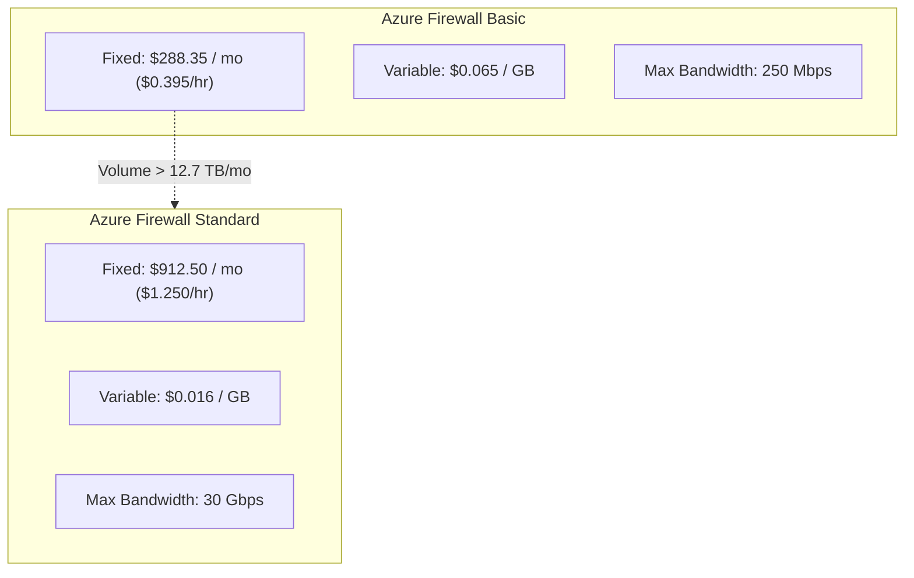

# 06. Hybrid Network Economics: ExpressRoute, Azure Firewall & PaaS Endpoints

> 🧭 **Navigation**: [🏠 Framework Root](../README.md) | [📚 Documentation Index](README.md) | [⬅️ Previous: 05. Decoupled Storage](05-storage-optimization-premium-ssdv2.md) | [➡️ Next: 07. Observability Containment](07-observability-ama-dcr-log-analytics.md)

> 📽️ **Video Guide**: Watch the technical short [**How Cloud Unlimited Plans Trap You**](https://www.youtube.com/shorts/Xd2adpKN6VM) (`1:24`) detailing the 240 TB/mo break-even threshold on ExpressRoute and the irreversible downgrade lock.

## 1. Network Asymmetry in Cloud Architecture

Cloud hyperscalers implement an asymmetrical billing policy for network data:
- **Ingress (Inbound data)**: 100% Free across all regions and interfaces.
- **Egress (Outbound data)**: Incurs consumption charges based on routing destination (Internet, cross-region peering, or hybrid on-premises connections).

In a hybrid IaaS environment, network costs often hide behind ambiguous infrastructure invoices. Unraveling these costs requires analyzing three foundational network layers:
1. ExpressRoute Connectivity
2. Hub Firewall Inspection
3. PaaS Service Endpoints vs. Private Endpoints

---

## 2. ExpressRoute: The Break-Even Reality

Azure ExpressRoute provides dedicated private fiber connectivity between on-premises corporate datacenters and the Azure Cloud.
Enterprises face a binary tariff decision:
- **Metered Plan**: Fixed monthly port fee + per-GB outbound egress charge (~$0.025/GB in Zone 1).
- **Unlimited Plan**: Fixed flat port fee covering all egress traffic.

### 2.1 The Financial Fallacy of "Predictability"
Many corporate procurement departments choose Unlimited under the assumption that fixed costs prevent budget surprises.
However, as demonstrated in our [ExpressRoute Mathematical Model](math-models/expressroute-breakeven.md):
- On a 1 Gbps circuit, the Unlimited plan costs **$6,450/month**, while Metered costs **$436/month**.
- The break-even egress volume is **240.6 Terabytes per month**—requiring sustained **73.2% continuous link saturation 24/7/365**.
- A typical hybrid enterprise transferring 5 to 10 TB/month spends **~$560 to $686/month on Metered**, compared to **$6,450/month on Unlimited**, wasting over **$69,000 annually per circuit**.

### 2.2 The Asymmetric Administrative Lock-in
- **Upgrading (Metered -> Unlimited)**: Zero downtime, executed in seconds via Azure Portal or CLI.
- **Downgrading (Unlimited -> Metered)**: **Strictly prohibited in-place by Microsoft**. Requires circuit deletion, telecom contract renegotiation, and hours of network downtime.
- **FinOps Standard**: Always provision **Metered**. Escalate to Unlimited only after empirical telemetry validates sustained >70% utilization.

---

## 3. Azure Firewall Economics & SKU Sizing

The central Azure Firewall in the Hub VNet inspects all North-South (Internet/On-Prem) and East-West (Spoke-to-Spoke) traffic.
Pricing combines a **fixed hourly fee** and a **variable data processing fee**:

### 3.1 Crossover Analysis
- Although Azure Firewall Basic has a lower fixed fee ($288/mo vs. $912/mo), its variable fee ($0.065/GB) is **4x higher** than Standard ($0.016/GB).
- As proven in our [Firewall Mathematical Model](math-models/firewall-sku-crossover.md), the **exact mathematical crossover point is 12.74 TB/month**.
- If a spoke moves large database backups or high-throughput batch files across the hub, Azure Firewall Basic quickly surpasses the cost of Standard, while suffering a 250 Mbps throughput throttle.

### 3.2 Automated Deallocation for Non-Production Hubs
In staging or development hubs, running Azure Firewall 24/7 costs $912/month in idle fixed charges.
FinOps automation scripts should deconstruct or stop the firewall outside business hours (e.g. running 10 hours/day weekdays), reducing monthly fixed costs to **~$275/month** (a $637/month saving).

---

## 4. PaaS Traffic Isolation: Service Endpoints vs. Private Endpoints

When VMs in spoke subnets communicate with Azure PaaS services (Azure Storage for backups, Azure Key Vault for secrets), architects must choose how to isolate traffic:

| Dimension | Service Endpoints | Private Endpoints (Private Link) |
| :--- | :--- | :--- |
| **Direct Cost** | **100% FREE ($0.00 / hr)** | **~$7.30 / mo per endpoint** |
| **Data Processing Cost** | **$0.00 / GB** | **$0.01 / GB (Inbound + Outbound)** |
| **DNS Requirements** | Zero changes to corporate DNS | Requires Azure Private DNS Zones + CNAME forwarding |
| **Network Path** | Microsoft Azure global backbone | Private IP allocated inside customer subnet |
| **On-Premises Access** | Not reachable across ExpressRoute | Accessible natively across ExpressRoute |
| **FinOps Guidance** | **DEFAULT CHOICE** for VNet-to-PaaS | Reserve strictly for on-prem PaaS access or strict PCI compliance |

> [!TIP]
> **FinOps Rule of Thumb**: Default to **Virtual Network Service Endpoints** for all internal Azure VM-to-PaaS communication. Only deploy Private Endpoints when an on-premises host must reach the Azure PaaS resource via ExpressRoute or when strict regulatory mandates explicitly forbid public IP exposure.

---

## 🧭 Navigation & Reading Path

| [⬅️ Previous: 05. Decoupled Storage](05-storage-optimization-premium-ssdv2.md) | [📚 Documentation Index](README.md) | [➡️ Next: 07. Observability Containment](07-observability-ama-dcr-log-analytics.md) |
| :--- | :---: | ---: |
| [🏠 Return to Framework Root](../README.md) | **[Interactive Docs Directory](README.md)** | [Next Thematic Module ➡️](07-observability-ama-dcr-log-analytics.md) |

