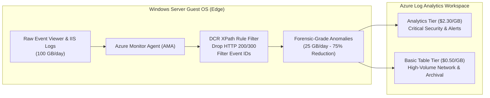

# 07. Observability Cost Containment: AMA, DCR Edge Filtering & Table Plans

## 1. The "Runaway Telemetry" Syndrome

In enterprise Windows Server environments running Internet Information Services (IIS) and self-managed SQL Server databases, telemetry generation is continuous:
- W3C web server access logs.
- Windows Event Viewer logs (Security, Application, System).
- High-frequency performance counters (CPU %, available memory, disk queue length).

Under legacy monitoring architectures (Log Analytics Agent / MMA), all raw logs were streamed directly to Azure Log Analytics.
At an ingestion rate of **~$2.30 per GB**, uninhibited telemetry often creates a monthly log invoice that **exceeds the cost of the virtual machine generating the logs**.

---

## 2. The Azure Monitor Agent (AMA) Paradigm

Microsoft's modern monitoring architecture replaces legacy monolithic agents with the **Azure Monitor Agent (AMA)**, governed declaratively by **Data Collection Rules (DCR)**.

Unlike legacy agents, AMA executes log filtering at the **Edge** (inside the Windows guest operating system) before network transmission:
- Evaluates **XPath queries** against events inside the local operating system kernel.
- Discards unneeded white noise before data ever crosses the network or incurs ingestion charges.



---

## 3. Production XPath Filtering Recipes

### 3.1 IIS Web Server Access Logs
Default IIS logs record every HTTP 200 OK asset request (CSS, JavaScript, images), generating gigabytes of useless noise.
FinOps-optimized DCR XPath query:
- Discard all HTTP status codes 200 through 399.
- Collect only HTTP 4xx (client errors), 5xx (server crashes), and requests where execution duration exceeds latency thresholds:

```xml
W3CIISLog | where scStatus >= 400 or timeTaken >= 3000
```

### 3.2 Windows Security Event Logs
Windows Security Event Viewer generates thousands of Event ID 4688 entries (Process Creation) every hour.
FinOps-optimized XPath filter collects only actionable forensic events:

```xml
Security!*[System[(EventID=4625 or EventID=4672 or EventID=4720 or EventID=4726 or EventID=4738)]]
```
- `4625`: An account failed to log on (Brute force detection).
- `4672`: Special privileges assigned to new logon (Privilege escalation).
- `4720` / `4726`: User account created / deleted.
- `4738`: User account modified.

### 3.3 Dynamic Performance Counter Sampling
On secondary web servers or auxiliary batch instances, default performance counters sample metrics every 10 seconds.
- Extend collection sampling intervals from **10 seconds to 60 seconds (or 300 seconds)**.
- Reduces performance counter metric ingestion volume by **83% to 96%** without sacrificing capacity planning fidelity.

---

## 4. Log Analytics Table Plans: Basic vs. Analytics

Log Analytics provides multiple **Table Plans** with differing cost profiles:

| Feature / Dimension | Analytics Table Plan | Basic Table Plan | Savings / Delta |
| :--- | :--- | :--- | :--- |
| **Ingestion Cost** | ~$2.30 / GB | **~$0.50 / GB** | **>78% Cost Reduction** |
| **Included Retention** | 30 days | 8 days | Suited for transient data |
| **Archived Retention** | Up to 12 years ($0.02/GB/mo) | Up to 12 years ($0.02/GB/mo) | Same compliance retention |
| **Interactive Querying**| Full KQL queries, alerts, dashboards | Basic KQL queries, search jobs | Simplified queries |
| **Recommended Tables** | `SecurityEvent`, `AppTraces`, `Alerts` | `AzureDiagnostics`, `AZFWNetworkRule` | Ideal for firewall & network |

> [!TIP]
> Route high-volume Azure Firewall denial logs, NSG flow logs, and IIS raw diagnostic streams to the **Basic Table Plan** to slash workspace ingestion bills while maintaining compliance archives.
