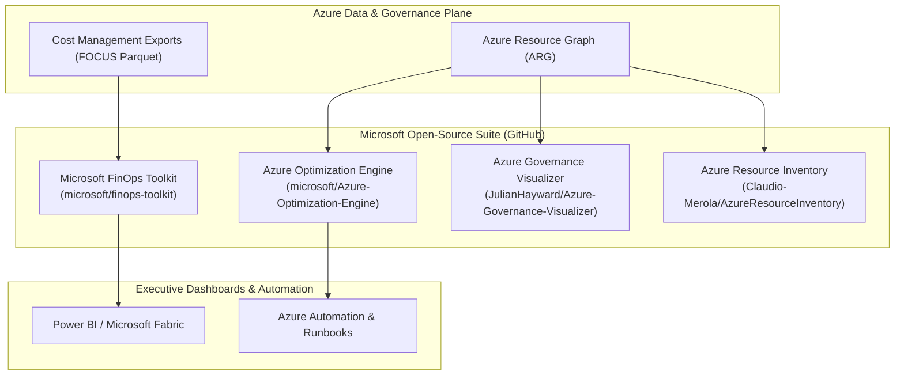

# 09. Modern FinOps Tooling Ecosystem (2026): Microsoft & Open-Source Solutions

## 1. Executive Summary & Evolution of Cloud Cost Tooling

In 2026, FinOps tooling has evolved from retrospective monthly spreadsheet audits into **real-time policy-as-code, shift-left IaC cost estimation, and automated lakehouse telemetry**. 
Optimizing an enterprise hybrid Azure IaaS environment requires a multi-layered toolchain combining:
1. **Microsoft First-Party & Open-Source Tools**: Native platform intelligence, standardized FOCUS 1.0 schemas, and deep hypervisor telemetry.
2. **Third-Party & Community Open-Source Projects (GitHub)**: Shift-left pre-merge CI/CD cost checks, SQL-based multi-cloud querying, and automated YAML policy engines.
3. **Autonomous & AI-Driven Platforms**: Machine learning algorithms that automate real-time rightsizing and dynamic rate optimization.

This document analyzes the leading tools in 2026, providing canonical repository links, architecture integration blueprints, step-by-step installation guides, and practical command-line examples.

---

## 2. Microsoft First-Party & Open-Source Tools (GitHub)



### 2.1. Microsoft FinOps Toolkit
- **Repository**: [`microsoft/finops-toolkit`](https://github.com/microsoft/finops-toolkit)
- **Official Documentation**: [https://microsoft.github.io/finops-toolkit/](https://microsoft.github.io/finops-toolkit/)
- **License**: MIT
- **Role**: The official open-source suite maintained by Microsoft to accelerate FinOps adoption based on the **FinOps Open Cost and Usage Specification (FOCUS 1.0/1.1)**.
- **Core Components**:
  - **FinOps Hubs**: Automated data pipeline deployed via Bicep/Terraform that ingests daily Cost Management exports (in Apache Parquet format) into an Azure Data Lake Storage Gen2 account, transforms data into normalized FOCUS schema using Azure Data Factory, and feeds Microsoft Fabric and Power BI.
  - **FinOps Workbooks**: Pre-built interactive Azure Monitor workbooks for commitment discount tracking, hybrid licensing, and storage rightsizing.
  - **Power BI Starter Kits**: Executive dashboards covering Amortized vs. Billed costs, showback/chargeback allocation, and unit economics.

#### Quickstart: Deploying FinOps Hubs via Azure CLI
```bash
# Clone the FinOps Toolkit
git clone https://github.com/microsoft/finops-toolkit.git
cd finops-toolkit/src/templates

# Deploy FinOps Hub into your central management subscription
az deployment sub create \
  --location westeurope \
  --template-file hub.bicep \
  --parameters \
    hubName='finops-hub-prod' \
    storageLocation='spaincentral' \
    exportType='FocusCost'
```

---

### 2.2. Azure Optimization Engine (AOE)
- **Repository**: [`microsoft/Azure-Optimization-Engine`](https://github.com/microsoft/Azure-Optimization-Engine)
- **License**: MIT
- **Role**: An extensible, automated reporting and remediation engine designed specifically for Enterprise Agreement (EA) and Microsoft Customer Agreement (MCA) customers.
- **Mechanics**:
  - Runs on a scheduled Azure Automation runbook.
  - Pulls continuous telemetry from Azure Resource Graph, Azure Advisor, and Azure Monitor across multiple tenants and management groups.
  - Aggregates findings in an Azure SQL Database or Log Analytics workspace.
  - Generates actionable workbooks highlighting underutilized SQL Server VMs, unconstrained cores, and candidate disks for Premium SSD v2.

#### Example: Deploying AOE via PowerShell
```powershell
# Install Azure Optimization Engine deployment module
Install-Module -Name AzureOptimizationEngine -Scope CurrentUser

# Execute automated deployment against the central FinOps subscription
Deploy-AzureOptimizationEngine -SubscriptionId "00000000-0000-0000-0000-000000000000" `
                               -Location "spaincentral" `
                               -WorkspaceName "law-finops-core"
```

---

### 2.3. Azure Governance Visualizer (AzGovViz)
- **Repository**: [`JulianHayward/Azure-Governance-Visualizer`](https://github.com/JulianHayward/Azure-Governance-Visualizer)
- **License**: MIT
- **Role**: An open-source PowerShell tool that generates rich, interactive HTML reports illustrating the complete governance posture of an Azure tenant.
- **FinOps Value**:
  - Visualizes subscription hierarchy and management group boundaries.
  - Audits Azure Policy assignments and enforcement modes (`Deny` vs. `Audit`).
  - Highlights untagged resources and unmanaged cost sprawl in a single interactive browser report.

#### Execution Example (Local or Pipeline):
```powershell
# Run AzGovViz against a Management Group root
.\AzGovViz.ps1 -ManagementGroupId "mg-corporate-root" `
               -OutputPath "C:\Reports\AzGovViz" `
               -DoAzurePolicyCompliance `
               -DoResourceGroupLimits
```

---

### 2.4. Azure Resource Inventory (ARI)
- **Repository**: [`Claudio-Merola/AzureResourceInventory`](https://github.com/Claudio-Merola/AzureResourceInventory)
- **License**: MIT
- **Role**: A widely adopted open-source PowerShell module that generates comprehensive Excel inventories of all assets across tenant subscriptions, complete with dedicated FinOps audit tabs.
- **FinOps Features**:
  - Automatically identifies stopped (non-deallocated) virtual machines.
  - Highlights unattached OS and Data disks.
  - Detects Public IPs with zero network associations.
  - Identifies SQL VMs missing Azure Hybrid Benefit (AHB).

#### Execution Example:
```powershell
# Install ARI from PowerShell Gallery
Install-Module -Name AzureResourceInventory -Scope CurrentUser

# Run complete audit with FinOps optimizations included
Invoke-ARI -SubscriptionId "00000000-0000-0000-0000-000000000000" `
           -IncludeFinOps `
           -ReportDir "C:\FinOpsAudit" `
           -AppInsights
```

---

## 3. Third-Party & Community Open-Source Tools (GitHub)

### 3.1. Infracost: Shifting FinOps Left to CI/CD
- **Repository**: [`infracost/infracost`](https://github.com/infracost/infracost)
- **Documentation**: [https://www.infracost.io/docs/](https://www.infracost.io/docs/)
- **License**: Apache 2.0
- **Role**: The industry standard for **shift-left cloud cost estimation**. Parses Terraform HCL and Bicep pull requests before deployment and posts automated cost diff comments.

```mermaid
graph LR
    Dev[Developer / DevOps] -->|git push branch| PR[Pull Request in GitHub / Azure DevOps]
    PR --> GHA[Infracost CI Pipeline]
    GHA --> CloudPricing[Infracost Cloud Pricing API]
    GHA --> Comment[Automated PR Comment with Monthly Cost Diff ($ & €)]
    Comment --> Reviewer{FinOps / Tech Lead Review}
    Reviewer -->|Approved| Merge[Merge & Deploy Terraform]
```

#### GitHub Actions Workflow Example (`.github/workflows/infracost.yml`):
```yaml
name: Infracost PR Cost Diff
on: [pull_request]

jobs:
  infracost:
    runs-on: ubuntu-latest
    steps:
      - uses: actions/checkout@v4
      - uses: infracost/actions/setup@v3
        with:
          api-key: ${{ secrets.INFRACOST_API_KEY }}

      - name: Generate Infracost Cost Diff
        run: |
          infracost breakdown --path=terraform \
                              --format=json \
                              --out-file=infracost.json
          infracost comment github --path=infracost.json \
                                  --repo=$GITHUB_REPOSITORY \
                                  --github-token=${{ secrets.GITHUB_TOKEN }} \
                                  --pull-request=${{ github.event.pull_request.number }} \
                                  --behavior=update
```

---

### 3.2. Steampipe & Azure Compliance Mod
- **Repository**: [`turbot/steampipe`](https://github.com/turbot/steampipe) & [`turbot/steampipe-mod-azure-compliance`](https://github.com/turbot/steampipe-mod-azure-compliance)
- **License**: AGPL v3
- **Role**: Exposes Azure APIs as relational SQL tables. Enables querying live infrastructure using standard SQL to discover cost anomalies and non-compliant assets.

#### Example: Querying Orphaned Disks with Steampipe SQL
```sql
-- Query unattached disks costing money across all subscriptions
select
  name,
  resource_group,
  disk_size_gb,
  sku_name,
  location
from
  azure_compute_disk
where
  managed_by is null
order by
  disk_size_gb desc;
```

#### Example: Querying VMs Stopped from Guest OS (Billed 100%)
```sql
select
  name,
  resource_group,
  power_state,
  vm_size
from
  azure_compute_virtual_machine
where
  power_state = 'stopped'; -- Not 'deallocated'
```

---

### 3.3. Cloud Custodian (c7n)
- **Repository**: [`cloud-custodian/cloud-custodian`](https://github.com/cloud-custodian/cloud-custodian)
- **License**: Apache 2.0
- **Role**: Declarative policy-as-code rule engine written in YAML. Used by Fortune 500 enterprises to automatically enforce tagging, power states, and resource lifecycle.

#### Example Policy: Deallocating Non-Prod VMs at 19:00 Weekdays (`policy-shutdown.yml`)
```yaml
policies:
  - name: deallocate-untagged-dev-vms-offhours
    resource: azure.vm
    filters:
      - type: value
        key: "tags.Environment"
        op: in
        value: ["Dev", "Test", "QA"]
      - type: instance-view
        key: "statuses[1].code"
        op: eq
        value: "PowerState/running"
    actions:
      - type: stop # Triggers Stop-AzVM (Deallocate)
```

---

## 4. Comparison Matrix: 2026 FinOps Tooling Ecosystem

| Tool | Category | Open Source? | Best For | Deployment Model |
| :--- | :--- | :---: | :--- | :--- |
| **Microsoft FinOps Toolkit** | Reporting & Ingestion | ✅ Yes (MIT) | Normalizing FOCUS 1.0/1.1 cost data into Fabric & Power BI | Azure Data Factory + ADLS Gen2 |
| **Azure Optimization Engine**| Optimization Engine | ✅ Yes (MIT) | Multi-subscription ARG automated recommendation processing | Azure Automation + Log Analytics |
| **AzGovViz** | Governance Visualization | ✅ Yes (MIT) | Auditing policy compliance, management hierarchies, and RBAC | PowerShell / CI/CD pipeline |
| **Azure Resource Inventory** | Asset Discovery | ✅ Yes (MIT) | Deep discovery Excel sheets with dedicated FinOps tab | PowerShell CLI |
| **Infracost** | Shift-Left IaC FinOps | ✅ Yes (Apache 2.0)| Pre-merge pull request cost estimations on Terraform/Bicep | GitHub Actions / GitLab CI / AzDO |
| **Steampipe** | Live SQL Auditing | ✅ Yes (AGPL) | Ad-hoc SQL querying across live Azure cloud infrastructure | Local CLI / Docker |
| **Cloud Custodian** | Autonomous Governance | ✅ Yes (Apache 2.0)| Declarative YAML automated remediation and off-hours scheduling | Container / Scheduled Task |
| **Sedai / ProsperOps** | Commercial Autonomous AI | ❌ Commercial | Continuous automated rightsizing and commitment optimization | Managed SaaS |
