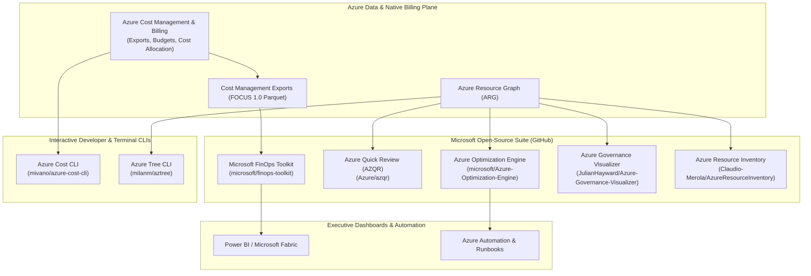
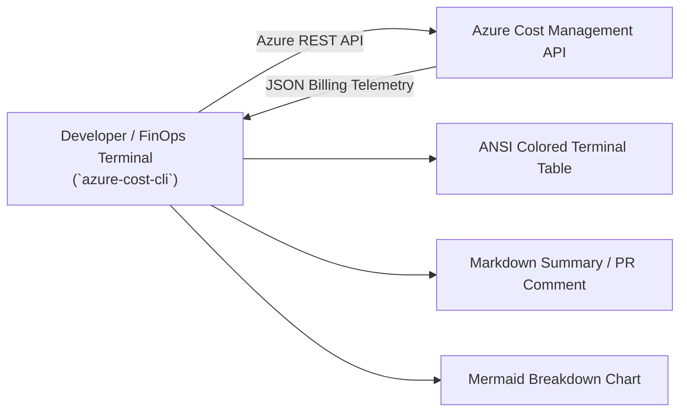
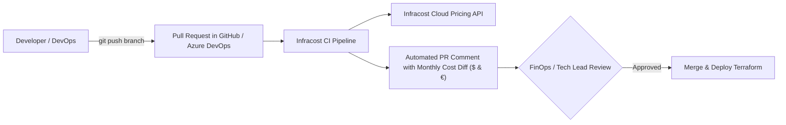

# 09. Modern FinOps Tooling Ecosystem (2026): Microsoft & Open-Source Solutions

> 🧭 **Navigation**: [🏠 Framework Root](../README.md) | [📚 Documentation Index](README.md) | [⬅️ Previous: 08. Anti-Patterns & Gotchas](08-anti-patterns-and-gotchas.md) | [➡️ Next: 10. Audit Playbook](10-audit-optimization-playbook-step-by-step.md)

> 📽️ **Video Guide**: Watch the technical short [**Turning Azure FinOps Theory into Automated Action**](https://www.youtube.com/shorts/09oqxYUeHd8) (`1:19`) on building a continuous automation pipeline with Terraform, Bicep, Azure Resource Graph KQL, and PowerShell runbooks.

## 1. Executive Summary & Evolution of Cloud Cost Tooling

In 2026, FinOps tooling has evolved from retrospective monthly spreadsheet audits into **real-time policy-as-code, shift-left IaC cost estimation, interactive terminal CLIs, and automated lakehouse telemetry**. 

Optimizing an enterprise hybrid Azure IaaS environment requires a multi-layered toolchain combining:
1. **Microsoft Native & First-Party Platforms**: Azure Cost Management & Billing native platform intelligence, standardized FOCUS 1.0/1.1 schemas, and deep hypervisor telemetry.
2. **Microsoft Open-Source Projects (GitHub)**: Community-driven tools built by Microsoft engineering teams, including the FinOps Toolkit, Azure Optimization Engine (AOE), Azure Quick Review (AZQR), Azure Governance Visualizer (AzGovViz), and Azure Resource Inventory (ARI).
3. **Third-Party & Community Open-Source Projects (GitHub)**: Interactive terminal utilities like `azure-cost-cli` and `aztree`, shift-left pre-merge CI/CD cost checks with Infracost, zero-ETL live querying with Steampipe, and automated YAML rule engines with Cloud Custodian.
4. **Autonomous & AI-Driven Platforms**: Continuous autonomous rightsizing and dynamic rate optimization engines (ProsperOps, Sedai).

This document analyzes the leading tools in 2026, providing canonical repository links, architecture integration blueprints, step-by-step installation guides, and practical command-line examples.

---

## 2. Microsoft First-Party & Open-Source Tools



---

### 2.1. Azure Cost Management & Billing (Native Platform Intelligence)
- **Official Documentation**: [https://learn.microsoft.com/en-us/azure/cost-management-billing/](https://learn.microsoft.com/en-us/azure/cost-management-billing/)
- **Role**: Native foundation for enterprise cost tracking, proactive governance, and automated financial guardrails.
- **Key Enterprise Capabilities in 2026**:
  - **FOCUS 1.0/1.1 Scheduled Exports**: Automated daily exports of raw billing data transformed into the FinOps Open Cost and Usage Specification (FOCUS) format, stored directly as compressed Apache Parquet in ADLS Gen2.
  - **Cost Allocation Rules**: Automatically splits central shared service costs (Hub Firewall, ExpressRoute Gateways, shared backup vaults) and redistributes them proportionally to consuming Spoke subscriptions based on actual network throughput or core count.
  - **Anomaly Detection & AI Alerts**: Employs built-in machine learning models to detect abnormal spending spikes within 24 hours of resource provisioning, issuing webhook alerts to Slack/Teams before invoices generate.
  - **Budgets with Automated Action Groups**: Triggers Azure Automation runbooks or Logic Apps when consumption crosses 80%, 90%, or 100% of forecasted monthly spend.

#### Azure CLI Configuration Example: Creating an Automated Budget with Alert Thresholds
```bash
# Create an Azure Cost Budget with 80% and 100% notification thresholds
az consumption budget create \
  --budget-name "budget-hybrid-iaas-prod" \
  --amount 45000 \
  --category "Cost" \
  --time-grain "Monthly" \
  --start-date "2026-01-01" \
  --end-date "2026-12-31" \
  --resource-group "rg-finops-core-prod" \
  --notification-key "approaching-limit" \
    --notification-enabled true \
    --notification-operator "GreaterThan" \
    --notification-threshold 80 \
    --contact-emails "finops-team@enterprise.com" \
    --contact-roles "Owner" "Contributor"
```

---

### 2.2. Microsoft FinOps Toolkit
- **Repository**: [`microsoft/finops-toolkit`](https://github.com/microsoft/finops-toolkit)
- **Official Documentation**: [https://microsoft.github.io/finops-toolkit/](https://microsoft.github.io/finops-toolkit/)
- **License**: MIT
- **Role**: The official open-source suite maintained by Microsoft to accelerate FinOps adoption based on the **FinOps Open Cost and Usage Specification (FOCUS 1.0/1.1)**.
- **Core Components**:
  - **FinOps Hubs**: Automated data pipeline deployed via Bicep/Terraform that ingests daily Cost Management exports (in Apache Parquet format) into an Azure Data Lake Storage Gen2 account, transforms data into normalized FOCUS schema using Azure Data Factory, and feeds Microsoft Fabric and Power BI.
  - **FinOps Workbooks**: Pre-built interactive Azure Monitor workbooks for commitment discount tracking, hybrid licensing, and storage rightsizing.
  - **Power BI Starter Kits**: Executive dashboards covering Amortized vs. Billed costs, showback/chargeback allocation, and unit economics.

#### Quickstart: Deploying FinOps Hubs via Azure CLI
```bash
# Clone the FinOps Toolkit
git clone https://github.com/microsoft/finops-toolkit.git
cd finops-toolkit/src/templates

# Deploy FinOps Hub into your central management subscription
az deployment sub create \
  --name "deploy-finops-hub-prod" \
  --location "spaincentral" \
  --template-file "./finops-hub/main.bicep" \
  --parameters hubName="finopshubprod" storageSku="Standard_GRS"
```

---

### 2.3. Azure Quick Review (AZQR)
- **Repository**: [`Azure/azqr`](https://github.com/Azure/azqr)
- **License**: MIT
- **Language**: Go
- **Role**: Official Microsoft command-line engine designed to execute rapid, automated architecture reviews of Azure Subscriptions and Resource Groups against the **Azure Well-Architected Framework (WAF)** and Cloud Adoption Framework (CAF).
- **FinOps & Cost Optimization Capabilities**:
  - Evaluates compute, networking, storage, and database resources against Cost Optimization, Reliability/SLA, and Security best practices.
  - Detects unattached disks, unassociated Public IPs, missing SLAs, and oversized SKUs without availability zone redundancy.
  - Scans across all major IaaS and PaaS services (VMs, Disks, SQL VMs, App Services, Firewalls, ExpressRoute Gateways, Key Vaults, AKS).
  - Generates comprehensive Excel spreadsheets and Markdown tables containing executive scorecards and prioritized remediation checklists.

#### Installation & Practical Usage:
```bash
# Option 1: Install via Go
go install github.com/Azure/azqr/cmd/azqr@latest

# Option 2: Download precompiled binary (Linux x64)
curl -sL https://github.com/Azure/azqr/releases/latest/download/azqr-ubuntu-latest-amd64.tar.gz | tar -xz
sudo mv azqr /usr/local/bin/

# Authenticate with Azure CLI
az login

# Run full Well-Architected & Cost audit for a subscription
azqr scan --subscription-id "<SUBSCRIPTION_GUID>" \
          --output-format excel,markdown \
          --output-dir "./audit-reports/azqr"
```

**Sample Output Markdown Table Generated by AZQR**:
```text
| Service | Resource Name | WAF Pillar | Rule | Impact | Recommendation |
| :--- | :--- | :--- | :--- | :--- | :--- |
| Compute | vm-sql-prod-01 | Cost | Azure Hybrid Benefit | High | Enable AHB to save 75% on licensing |
| Storage | disk-data-old-01 | Cost | Unattached Disk | High | Disk is unattached; create snapshot and delete |
| Network | pip-ingress-02 | Cost | Idle Public IP | Medium | Unassociated Static IP incurring hourly fees |
| Compute | vm-app-iis-04 | Reliability | Availability Zones | High | VM is not deployed in an Availability Zone |
```

---

### 2.4. Azure Optimization Engine (AOE)
- **Repository**: [`microsoft/Azure-Optimization-Engine`](https://github.com/microsoft/Azure-Optimization-Engine)
- **Official Documentation**: [https://microsoft.github.io/Azure-Optimization-Engine/](https://microsoft.github.io/Azure-Optimization-Engine/)
- **License**: MIT
- **Role**: Extensible, automated optimization framework built natively on Azure Automation, Log Analytics, and Azure Resource Graph.
- **Enterprise Features**:
  - Ingests telemetry across multiple tenants and subscriptions.
  - Evaluates Virtual Machine utilization against customizable rightsizing algorithms (e.g., custom P95 thresholds).
  - Automatically identifies abandoned App Service Plans, unattached disks, and idle SQL databases.

#### Deployment via PowerShell:
```powershell
# Install Azure Optimization Engine deployment module
Install-Module -Name AzureOptimizationEngine -Scope CurrentUser

# Execute automated deployment against the central FinOps subscription
Deploy-AzureOptimizationEngine -SubscriptionId "<CENTRAL_MGMT_SUB_ID>" `
                               -Location "spaincentral" `
                               -WorkspaceName "law-finops-telemetry"
```

---

### 2.5. Azure Governance Visualizer (AzGovViz)
- **Repository**: [`JulianHayward/Azure-Governance-Visualizer`](https://github.com/JulianHayward/Azure-Governance-Visualizer)
- **Author**: Julian Hayward (Principal FastTrack for Azure Engineer)
- **License**: MIT
- **Role**: The gold standard for visualizing and auditing Azure governance, RBAC hierarchies, Policy compliance, orphaned resources, and network topology.
- **FinOps Utilities**:
  - Visualizes complete Management Group hierarchies and identifies where Azure Policy exemptions exist.
  - Audits tagging compliance across thousands of subscriptions in a single unified HTML report.
  - Highlights orphaned resource groups, empty VNets, and unattached network interfaces.

#### Execution Example (Local or Pipeline):
```powershell
# Run AzGovViz against a Management Group root
pwsh -File ./pwsh/azgovviz.ps1 `
    -ManagementGroupId "mg-enterprise-root" `
    -OutputPath "./reports/governance-viz" `
    -CsvExport $true `
    -HtmlReport $true
```

---

### 2.6. Azure Resource Inventory (ARI)
- **Repository**: [`Claudio-Merola/AzureResourceInventory`](https://github.com/Claudio-Merola/AzureResourceInventory)
- **Author**: Claudio Merola (Senior Cloud Solution Architect at Microsoft)
- **License**: MIT
- **Role**: PowerShell-based utility that extracts a full catalog of all provisioned cloud resources into a structured Excel workbook with dedicated FinOps overlays.
- **FinOps Analysis Included**:
  - Automatically identifies stopped (non-deallocated) virtual machines.
  - Highlights unattached OS and Data disks.
  - Detects Public IPs with zero network associations.
  - Identifies SQL VMs missing Azure Hybrid Benefit (AHB).

#### Execution Example:
```powershell
# Install ARI from PowerShell Gallery
Install-Module -Name AzureResourceInventory -Scope CurrentUser

# Run complete audit with FinOps optimizations included
Invoke-ARI -SubscriptionId "<SUBSCRIPTION_GUID>" `
           -IncludeFinOps `
           -ReportDir "./reports/ari-audit"
```

---

## 3. Third-Party & Community Open-Source Tools (GitHub)

### 3.1. Azure Cost CLI (`mivano/azure-cost-cli`)
- **Repository**: [`mivano/azure-cost-cli`](https://github.com/mivano/azure-cost-cli)
- **Author**: Michiel van Oudheusden
- **License**: MIT
- **Role**: Interactive command-line interface for querying, analyzing, and formatting Azure costs directly in developer terminals and CI/CD pipelines.
- **Key Features for Hybrid Estates**:
  - Queries daily, accumulated, and projected costs without loading the Azure Portal.
  - Groups spending by Resource Group, Subscription, Service Name, and custom Tags (`Environment`, `CostCenter`).
  - Supports multiple output currencies: `--currency EUR` (€) and `--currency USD` ($).
  - Exports cleanly to Markdown tables, CSV, JSON, and Mermaid charts for automated pull-request comments or executive summaries.



#### Installation:
```bash
# Option 1: Install as a global .NET Tool
dotnet tool install -g azure-cost-cli

# Option 2: Run via Docker / OCI container
docker run --rm -it -v ~/.azure:/root/.azure ghcr.io/mivano/azure-cost-cli:latest
```

#### Practical Usage Examples:
```bash
# 1. View accumulated costs for the current calendar month in Euros (€)
azure-cost accumulated --currency EUR --output text

# 2. Group monthly costs by Resource Group with Markdown output
azure-cost by-resourcegroup --currency EUR --output markdown > cost-by-rg.md

# 3. View daily spend trends for the past 14 days
azure-cost daily --days 14 --currency EUR

# 4. Filter spend by tag (e.g., CostCenter or Environment)
azure-cost by-tag --tag-name "CostCenter" --currency EUR
```

**Terminal Output Example**:
```text
Azure Cost CLI - Accumulated Spend (Month-to-Date)
Period: 2026-03-01 to 2026-03-15 | Currency: EUR (€)

Resource Group               Cost (€)    Budget (€)    Utilization (%)
----------------------------------------------------------------------
rg-hybrid-spoke-db          14,250.40    18,000.00         79.2%
rg-hybrid-spoke-web          6,840.15     9,000.00         76.0%
rg-hybrid-hub-security       4,120.00     5,000.00         82.4%
rg-monitoring-observability  1,890.30     2,500.00         75.6%
----------------------------------------------------------------------
Total Accumulated Spend:    €27,100.85   €34,500.00         78.6%
```

---

### 3.2. Azure Tree CLI (`milanm/aztree`)
- **Repository**: [`milanm/aztree`](https://github.com/milanm/aztree)
- **Author**: Milan Milanović
- **License**: MIT
- **Role**: Fast, lightweight CLI utility that visualizes Azure resource hierarchies (Tenant → Management Groups → Subscriptions → Resource Groups → Resources) in an interactive ANSI tree structure.
- **FinOps & Hygiene Utilities**:
  - Instantly reveals structural anti-patterns (e.g., forgotten resource groups with single orphaned disks).
  - Displays resource types, SKUs, and associated tags inline in the terminal.
  - Allows filtering by resource type (`Microsoft.Compute/disks`, `Microsoft.Network/publicIPAddresses`) to isolate waste.

#### Installation:
```bash
# Install via Go
go install github.com/milanm/aztree@latest

# Or download release binary
curl -sL https://github.com/milanm/aztree/releases/latest/download/aztree-linux-amd64.tar.gz | tar -xz
sudo mv aztree /usr/local/bin/
```

#### Practical Usage Examples:
```bash
# 1. Visualize full hierarchy of a subscription with tags
aztree --subscription "<SUBSCRIPTION_GUID>" --show-tags

# 2. Filter tree specifically for managed disks to identify orphans
aztree --subscription "<SUBSCRIPTION_GUID>" --type "Microsoft.Compute/disks"

# 3. Filter tree for public IP addresses
aztree --subscription "<SUBSCRIPTION_GUID>" --type "Microsoft.Network/publicIPAddresses"
```

---

### 3.3. Infracost: Shifting FinOps Left to CI/CD
- **Repository**: [`infracost/infracost`](https://github.com/infracost/infracost)
- **Documentation**: [https://www.infracost.io/docs/](https://www.infracost.io/docs/)
- **License**: Apache 2.0
- **Role**: The industry standard for **shift-left cloud cost estimation**. Parses Terraform HCL and Bicep pull requests before deployment and posts automated cost diff comments with budget policy checks.



#### GitHub Actions Workflow Example (`.github/workflows/infracost.yml`):
```yaml
name: Infracost PR Cost Diff
on: [pull_request]

jobs:
  infracost:
    runs-on: ubuntu-latest
    steps:
      - uses: actions/checkout@v4
      - uses: infracost/actions/setup@v3
        with:
          api-key: ${{ secrets.INFRACOST_API_KEY }}

      - name: Generate Infracost Cost Diff
        run: |
          infracost diff --path=iac/terraform/environments/production \
                         --format=json \
                         --currency=EUR \
                         --out-file=/tmp/infracost.json
          infracost comment github --path=/tmp/infracost.json \
                                  --repo=$GITHUB_REPOSITORY \
                                  --github-token=${{ secrets.GITHUB_TOKEN }} \
                                  --pull-request=${{ github.event.pull_request.number }} \
                                  --behavior=update
```

---

### 3.4. Steampipe & Azure Compliance Mod
- **Repository**: [`turbot/steampipe`](https://github.com/turbot/steampipe) & [`turbot/steampipe-mod-azure-compliance`](https://github.com/turbot/steampipe-mod-azure-compliance)
- **License**: AGPL v3
- **Role**: Exposes Azure APIs as relational SQL tables. Enables zero-ETL querying across live infrastructure to audit cost anomalies, unattached disks, and compliance status.

#### Example: Querying Orphaned Disks with Steampipe SQL
```sql
select
  name,
  resource_group,
  disk_size_gb,
  sku_name,
  location,
  round((disk_size_gb * 0.1214)::numeric, 2) as monthly_waste_eur
from
  azure_compute_disk
where
  managed_by is null
order by
  disk_size_gb desc;
```

#### Example: Querying VMs Stopped from Guest OS (Billed 100% CPU/RAM)
```sql
select
  name,
  resource_group,
  power_state,
  vm_size
from
  azure_compute_virtual_machine
where
  power_state = 'stopped'; -- Not 'deallocated'
```

---

### 3.5. Cloud Custodian (c7n)
- **Repository**: [`cloud-custodian/cloud-custodian`](https://github.com/cloud-custodian/cloud-custodian)
- **License**: Apache 2.0
- **Role**: Declarative policy-as-code rule engine written in YAML. Automatically enforces tagging, power states, and waste reclamation schedules across multi-cloud environments.

#### Example Policy: Deallocating Non-Prod VMs at 19:00 Weekdays (`policy-shutdown.yml`)
```yaml
policies:
  - name: deallocate-untagged-dev-vms-offhours
    resource: azure.vm
    filters:
      - type: value
        key: "tags.Environment"
        op: in
        value: ["Dev", "Test", "QA"]
      - type: instance-view
        key: "statuses[1].code"
        op: eq
        value: "PowerState/running"
    actions:
      - type: stop # Triggers Stop-AzVM (Deallocate)
```

---

### 3.6. Additional Complementary Audit & Security-FinOps Tools
- **Prowler for Azure** ([`prowler-cloud/prowler`](https://github.com/prowler-cloud/prowler)): Multi-cloud security, compliance, and cost waste scanner. Audits CIS benchmarks and flags unattached storage, abandoned public IPs, and unused network security groups.
- **Checkov** ([`bridgecrewio/checkov`](https://github.com/bridgecrewio/checkov)): Static code analysis tool for Terraform, Bicep, and ARM templates, enforcing financial and security guardrails before merge.

---

## 4. Comparison Matrix: 2026 FinOps Tooling Ecosystem

| Tool | Category | Maintainer / Repo | Open Source? | Primary Enterprise Use Case | Execution Model |
| :--- | :--- | :--- | :---: | :--- | :--- |
| **Azure Cost Management** | Native Billing Engine | Microsoft (Native) | Platform | Raw billing data, budgets, anomaly alerts, cost allocation rules | Azure Portal & REST API |
| **Microsoft FinOps Toolkit** | Reporting & Lakehouse | [`microsoft/finops-toolkit`](https://github.com/microsoft/finops-toolkit) | ✅ Yes (MIT) | Normalizing FOCUS 1.0/1.1 cost data into Fabric & Power BI | Azure Data Factory + ADLS Gen2 |
| **Azure Quick Review (AZQR)**| WAF & Cost Audit | [`Azure/azqr`](https://github.com/Azure/azqr) | ✅ Yes (MIT) | Instant CLI Well-Architected Framework and cost audit with Excel/MD reports | Go CLI / GitHub Actions |
| **Azure Cost CLI** | Terminal Cost Analytics| [`mivano/azure-cost-cli`](https://github.com/mivano/azure-cost-cli) | ✅ Yes (MIT) | Terminal-based cost queries, daily trends, and Markdown exports in € and $ | .NET Tool / Docker CLI |
| **Azure Tree (aztree)** | Topology & Hierarchy | [`milanm/aztree`](https://github.com/milanm/aztree) | ✅ Yes (MIT) | Visual tree hierarchy of resources, tags, and orphaned components | Go CLI |
| **Azure Optimization Engine**| Optimization Engine | [`microsoft/Azure-Optimization-Engine`](https://github.com/microsoft/Azure-Optimization-Engine) | ✅ Yes (MIT) | Multi-subscription ARG recommendation processing and rightsizing | Azure Automation + Log Analytics |
| **AzGovViz** | Governance Visualization| [`JulianHayward/Azure-Governance-Visualizer`](https://github.com/JulianHayward/Azure-Governance-Visualizer) | ✅ Yes (MIT) | Auditing policy compliance, management hierarchies, and RBAC | PowerShell / CI/CD pipeline |
| **Azure Resource Inventory** | Asset Discovery | [`Claudio-Merola/AzureResourceInventory`](https://github.com/Claudio-Merola/AzureResourceInventory) | ✅ Yes (MIT) | Deep discovery Excel workbooks with dedicated FinOps tab | PowerShell CLI |
| **Infracost** | Shift-Left IaC FinOps | [`infracost/infracost`](https://github.com/infracost/infracost) | ✅ Yes (Apache) | Pre-merge pull request cost estimations on Terraform/Bicep | GitHub Actions / AzDO |
| **Steampipe** | Live SQL Auditing | [`turbot/steampipe`](https://github.com/turbot/steampipe) | ✅ Yes (AGPL) | Ad-hoc SQL querying across live Azure cloud infrastructure | Local CLI / Docker |
| **Cloud Custodian** | Autonomous Governance | [`cloud-custodian/cloud-custodian`](https://github.com/cloud-custodian/cloud-custodian) | ✅ Yes (Apache) | Declarative YAML automated remediation and off-hours scheduling | Container / Scheduled Task |
| **Sedai / ProsperOps** | Commercial Autonomous AI| Proprietary | ❌ Commercial | Continuous automated rightsizing and commitment portfolio management | Managed SaaS |

---

## 🧭 Navigation & Reading Path

| [⬅️ Previous: 08. Anti-Patterns & Gotchas](08-anti-patterns-and-gotchas.md) | [📚 Documentation Index](README.md) | [➡️ Next: 10. Audit Playbook](10-audit-optimization-playbook-step-by-step.md) |
| :--- | :---: | ---: |
| [🏠 Return to Framework Root](../README.md) | **[Interactive Docs Directory](README.md)** | [Next Thematic Module ➡️](10-audit-optimization-playbook-step-by-step.md) |

