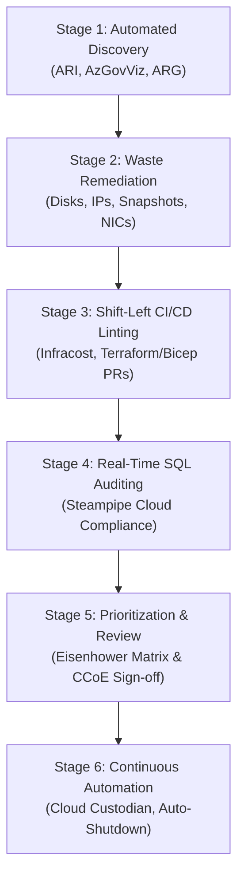
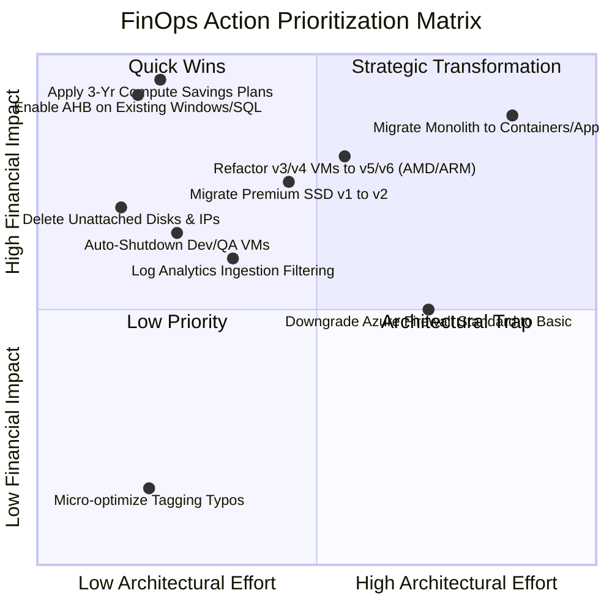

# 10. End-to-End Azure FinOps Audit & Optimization Playbook (Step-by-Step)

> 🧭 **Navigation**: [🏠 Framework Root](../README.md) | [📚 Documentation Index](README.md) | [⬅️ Previous: 09. FinOps Tooling (2026)](09-finops-tooling-ecosystem-2026.md) | [➡️ Next: 11. Enterprise Roadmap](11-enterprise-roadmap-calendar-milestones.md)

> 📽️ **Video Guide**: Watch [**Turning Azure FinOps Theory into Automated Action**](https://www.youtube.com/shorts/09oqxYUeHd8) (`1:19`) for an overview of the automated detection and remediation lifecycle.

## 1. Playbook Overview & Architecture

This playbook defines an actionable, repeatable, and enterprise-grade procedure for conducting automated FinOps audits and executing remediations across hybrid Azure IaaS estates. It bridges automated tooling—such as **Azure Resource Inventory (ARI)**, **Azure Resource Graph (ARG)**, **Infracost**, and **Steampipe**—with Day-2 remediation runbooks and continuous policy guardrails.



All monetary examples throughout this playbook are evaluated under both **USD ($)** and **EUR (€)** based on the standard European enterprise baseline ($1.00 USD = €0.92 EUR) across Zone 1 European regions (`spaincentral` - Madrid, `westeurope` - Netherlands) and reference region `eastus`.

---

## 2. Stage 1: Automated Discovery & Inventory Audit

The discovery phase establishes a comprehensive baseline of compute, network, storage, and identity assets without deploying invasive agents, utilizing modern CLI utilities and native discovery engines.

### Step 1.1: Rapid Terminal Cost Baseline with `azure-cost-cli`

Obtain an immediate breakdown of accumulated spend, budget status, and resource group cost attribution without leaving the terminal:

```bash
# Prerequisites: dotnet tool install -g azure-cost-cli
# Or via container: docker run --rm -it -v ~/.azure:/root/.azure ghcr.io/mivano/azure-cost-cli:latest

# Display accumulated month-to-date spend in Euros (€)
azure-cost accumulated --currency EUR --output text

# Export cost breakdown by Resource Group as Markdown table for executive review
azure-cost by-resourcegroup --currency EUR --output markdown > ./reports/cost-by-resourcegroup.md

# Inspect daily spend trends over the past 14 days to spot sudden anomalous jumps
azure-cost daily --days 14 --currency EUR
```

### Step 1.2: Visual Topology & Orphan Resource Hierarchy with `aztree`

Visualize Azure resource distribution and isolate structural waste (e.g., resource groups containing only orphaned disks or abandoned IPs):

```bash
# Prerequisites: go install github.com/milanm/aztree@latest

# Visualize the resource tree with tags to detect untagged or orphaned items
aztree --subscription "<SUBSCRIPTION_GUID>" --show-tags

# Filter tree specifically to inspect all managed disks across resource groups
aztree --subscription "<SUBSCRIPTION_GUID>" --type "Microsoft.Compute/disks"

# Filter tree for Public IP addresses to identify unassociated entries
aztree --subscription "<SUBSCRIPTION_GUID>" --type "Microsoft.Network/publicIPAddresses"
```

### Step 1.3: Automated Well-Architected & Cost Review with `azqr`

Execute Azure Quick Review (AZQR) to perform an automated scan of all subscription resources against the Azure Well-Architected Framework (WAF) cost and reliability rules:

```bash
# Prerequisites: go install github.com/Azure/azqr/cmd/azqr@latest

# Scan subscription and export both Excel scorecard and Markdown action tables
azqr scan --subscription-id "<SUBSCRIPTION_GUID>" \
          --output-format excel,markdown \
          --output-dir "./reports/azqr-waf-audit"
```

### Step 1.4: Deep Inventory with Azure Resource Inventory (ARI)

```powershell
# Prerequisites: Azure CLI and AzureResourceInventory module
Install-Module -Name AzureResourceInventory -Scope CurrentUser -Force

# Authenticate to tenant
Connect-AzAccount -TenantId "<TENANT_GUID>"

# Execute full inventory export with pricing, security, and governance overlays
Invoke-AzureResourceInventory `
    -TenantID "<TENANT_GUID>" `
    -SubscriptionID "<SUBSCRIPTION_GUID>" `
    -IncludeAdvisor `
    -IncludeSecurity `
    -IncludeCost `
    -ReportDir "./reports/finops-audit-$(Get-Date -Format 'yyyyMMdd')"
```

**Output Artifacts Generated**:
- `AzureResourceInventory_Report.xlsx`: Multi-tab workbook detailing every resource with its provisioning status, tags, and compute SKU.
- `Advisor_Recommendations.csv`: Microsoft Advisor cost anomalies and idle resource recommendations.
- `Diagram.vsdx` (optional): Topological map of Virtual Networks, Hub-Spoke peerings, and ExpressRoute gateways.

### Step 1.5: Execute Azure Resource Graph (ARG) KQL Audit Pack

Utilize the 7 pre-built KQL queries provided in this repository under [`kql-queries/`](../kql-queries/):

```bash
#!/usr/bin/env bash
set -euo pipefail

OUTPUT_DIR="./audit-results/$(date +%Y%m%d)"
mkdir -p "$OUTPUT_DIR"

echo "=== [1/7] Auditing Orphaned Disks ==="
az graph query -q "$(cat kql-queries/find-orphaned-managed-disks.kql)" \
    --output table | tee "$OUTPUT_DIR/orphaned-disks.txt"

echo "=== [2/7] Auditing Unassociated Public IPs ==="
az graph query -q "$(cat kql-queries/find-unassociated-public-ips.kql)" \
    --output table | tee "$OUTPUT_DIR/unassociated-public-ips.txt"

echo "=== [3/7] Auditing Stopped (Non-Deallocated) VMs ==="
az graph query -q "$(cat kql-queries/find-stopped-not-deallocated-vms.kql)" \
    --output table | tee "$OUTPUT_DIR/stopped-vms.txt"

echo "=== [4/7] Auditing VMs Missing Azure Hybrid Benefit (AHB) ==="
az graph query -q "$(cat kql-queries/find-vms-missing-hybrid-benefit.kql)" \
    --output table | tee "$OUTPUT_DIR/missing-ahb-vms.txt"

echo "=== [5/7] Auditing SQL VMs Eligible for Constrained vCPUs ==="
az graph query -q "$(cat kql-queries/find-sql-vms-eligible-for-constrained-vcpu.kql)" \
    --output table | tee "$OUTPUT_DIR/sql-constrained-candidates.txt"

echo "=== [6/7] Auditing Premium SSD v1 Candidates for v2 Migration ==="
az graph query -q "$(cat kql-queries/audit-premium-ssd-v1-to-v2-candidates.kql)" \
    --output table | tee "$OUTPUT_DIR/premium-v1-to-v2-candidates.txt"

echo "=== [7/7] Auditing Log Analytics Ingestion Spikes ==="
az graph query -q "$(cat kql-queries/audit-log-analytics-ingestion-spikes.kql)" \
    --output table | tee "$OUTPUT_DIR/log-ingestion-spikes.txt"

echo "Audit completed. Reports stored in $OUTPUT_DIR"
```

---

## 3. Stage 2: Immediate Waste Remediation Execution

Executing "Low-Hanging Fruit" cleanups eliminates unattached infrastructure that incurs recurring compute/storage fees without running workloads.

### Step 2.1: Quarantine and Deletion of Orphaned Disks

> [!WARNING]
> In production environments, never delete unattached managed disks without creating a temporary snapshot and verifying that the disk is not an off-line disaster recovery replica or failover cluster quorum disk.

```powershell
# Import the provided framework runbook
. ./automation/powershell/Cleanup-OrphanedDisks.ps1

# Dry-Run mode to assess impact
Invoke-OrphanedDiskAudit -QuarantineDays 14 -DryRun $true

# Execution with snapshot backup before deletion
Invoke-OrphanedDiskAudit `
    -ResourceGroupName "rg-legacy-iaas-spain" `
    -QuarantineDays 14 `
    -AutoSnapshot $true `
    -DryRun $false
```

**Direct Financial Impact Example (Monthly Savings)**:
- Ten (10) unattached `Premium SSD v1` disks (P30, 1024 GiB each):
  - **In USD ($)**: 10 × $135.17 = **$1,351.70 / month** ($16,220.40 / year).
  - **In EUR (€)**: 10 × €124.36 = **€1,243.60 / month** (€14,923.20 / year).

### Step 2.2: Releasing Disassociated Static Standard Public IPs

Standard Public IPs in Azure incur hourly reservation charges (~$0.005 / hour = ~$3.65 / month or €3.36 / month each) regardless of whether they are attached to an active NIC or Gateway.

```bash
# Query all disassociated Public IPs in a subscription
IDLE_IPS=$(az network public-ip list \
  --query "[?ipConfiguration==null && natGateway==null].{Name:name, ResourceGroup:resourceGroup}" \
  --output tsv)

while IFS=$'\t' read -r IP_NAME RG_NAME; do
  if [ -n "$IP_NAME" ]; then
    echo "Deleting idle Public IP: $IP_NAME in $RG_NAME"
    az network public-ip delete --name "$IP_NAME" --resource-group "$RG_NAME"
  fi
done <<< "$IDLE_IPS"
```

---

## 4. Stage 3: Shift-Left IaC Cost Linting with Infracost

To prevent cost regressions from reaching production environments, automated cost estimation is enforced on pull requests using Infracost.

### Step 3.1: Developer Local Pre-Commit Check

```bash
# Run diff against current Git branch and baseline main
infracost diff --path iac/terraform/environments/production \
  --currency EUR \
  --compare-to infracost-baseline.json
```

**Developer Console Feedback Example**:
```text
Project: iac/terraform/environments/production

+ azurerm_linux_virtual_machine.app_vm[0]
  + Instance usage (Standard_D8as_v5)                       €265.42
  + OS disk (Premium SSD v2, 128 GiB, 3000 IOPS, 125 MB/s)  €10.82

- azurerm_windows_virtual_machine.legacy_vm[0]
  - Instance usage (Standard_D8s_v3)                        €548.16
  - OS disk (Premium SSD v1, P30, 1024 GiB)                 €124.36

Monthly cost difference: -€396.28 (-58.9%)
```

### Step 3.2: Pull Request Gate in GitHub Actions

The workflow block defined in [`.github/workflows/finops-infracost.yml`](../.github/workflows/):
```yaml
name: "FinOps Infracost PR Gate"
on: [pull_request]

jobs:
  infracost:
    runs-on: ubuntu-latest
    steps:
      - name: Checkout code
        uses: actions/checkout@v4

      - name: Setup Infracost
        uses: infracost/actions/setup@v3
        with:
          api-key: ${{ secrets.INFRACOST_API_KEY }}

      - name: Generate Infracost Cost Estimate
        run: |
          infracost breakdown --path=iac/terraform/environments/production \
                              --format=json \
                              --currency=EUR \
                              --out-file=/tmp/infracost.json

      - name: Post Infracost PR Comment
        uses: infracost/actions/comment@v3
        with:
          path: /tmp/infracost.json
          behavior: update
```

---

## 5. Stage 4: Real-Time Fleet Auditing with Steampipe

Steampipe enables instant SQL querying across live Azure resource endpoints.

### Step 5.1: Multi-Subscription Disk Provisioning Oversizing Query

Identify all disks larger than 512 GiB that are deployed as Premium SSD v1 instead of Premium SSD v2:

```sql
-- file: audit-queries/oversized_premium_v1.sql
select
  name as disk_name,
  resource_group,
  disk_size_gb,
  sku_name,
  location,
  -- Calculate monthly waste compared to Premium SSD v2 (baseline €0.0805 vs €0.1214 per GB)
  round((disk_size_gb * (0.1214 - 0.0805))::numeric, 2) as monthly_excess_eur,
  round((disk_size_gb * (0.1320 - 0.0875))::numeric, 2) as monthly_excess_usd
from
  azure_compute_disk
where
  sku_name in ('Premium_LRS', 'Premium_ZRS')
  and disk_size_gb >= 512
order by
  disk_size_gb desc;
```

Execute via CLI:
```bash
steampipe query audit-queries/oversized_premium_v1.sql --output table
```

---

## 6. Stage 5: FinOps Remediation Prioritization (Eisenhower Matrix)

Prioritize recommendations identified during the audit using an Impact vs. Complexity matrix:



### Remediation Action Plan Table

| Action Category | Specific Remediation | Architectural Risk | Monthly Savings (100 VMs) USD | Monthly Savings (100 VMs) EUR | Priority |
| :--- | :--- | :--- | :--- | :--- | :--- |
| **Quick Win** | Activate Azure Hybrid Benefit (AHB) for Windows Server | Zero (Zero-downtime metadata toggle) | $18,400 | €16,928 | **P0 (Day 1-7)** |
| **Quick Win** | Delete orphaned disks, snapshots, and idle IPs | Low (Snapshot verification required) | $2,850 | €2,622 | **P0 (Day 1-7)** |
| **Quick Win** | Apply Compute Savings Plans (3-Year) for baseline compute | Zero (Pure commercial commitment) | $29,600 | €27,232 | **P1 (Day 8-15)** |
| **Medium Effort** | Migrate Premium SSD v1 (P30) to Premium SSD v2 | Medium (VM restart required for detached resize) | $5,620 | €5,170 | **P1 (Day 15-30)** |
| **Medium Effort** | Automated Nightly/Weekend VM Deallocation for Dev/Test | Low (Coordination with test teams) | $12,400 | €11,408 | **P1 (Day 15-30)** |
| **Strategic** | Ingestion-time filtering on Azure Log Analytics / Sentinel | Low/Medium (Security review of excluded Event IDs) | $6,200 | €5,704 | **P2 (Day 31-60)** |
| **Strategic** | Architectural refactoring: v3/v4 to v5/v6 (AMD/ARM64) | Medium (Testing OS drivers, Hyper-V gen 2) | $14,100 | €12,972 | **P2 (Day 31-90)** |

---

## 7. Stage 6: Governance Automation with Cloud Custodian

Deploy automated enforcement policies to ensure waste does not regenerate over time.

### Automated Orphaned Disk Janitor Policy

```yaml
# file: policies/cloud-custodian/disk-janitor.yml
policies:
  - name: azure-unattached-disk-janitor
    resource: azure.disk
    description: "Mark unattached disks for deletion after 14 days, then delete."
    filters:
      - type: value
        key: managedBy
        value: null
    actions:
      - type: mark-for-op
        op: delete
        days: 14
        tag: custodian_cleanup

  - name: azure-delete-marked-unattached-disks
    resource: azure.disk
    description: "Permanently delete disks marked by custodian."
    filters:
      - type: marked-for-op
        op: delete
    actions:
      - type: delete
```

Execution Command:
```bash
custodian run --output-dir=/var/log/custodian policies/cloud-custodian/disk-janitor.yml
```

---

## 8. Summary of Playbook Execution Cadence

```text
Daily:     Automated Cloud Custodian checks (idle IPs, untagged resources)
Weekly:    Shift-left Infracost PR telemetry reviewed by DevOps leads
Monthly:   ARG KQL fleet queries & CCoE FinOps review of unallocated spend
Quarterly: Reservation & Savings Plan true-up (expiry check & utilization >95%)
```

---

## 🧭 Navigation & Reading Path

| [⬅️ Previous: 09. FinOps Tooling (2026)](09-finops-tooling-ecosystem-2026.md) | [📚 Documentation Index](README.md) | [➡️ Next: 11. Enterprise Roadmap](11-enterprise-roadmap-calendar-milestones.md) |
| :--- | :---: | ---: |
| [🏠 Return to Framework Root](../README.md) | **[Interactive Docs Directory](README.md)** | [Next Thematic Module ➡️](11-enterprise-roadmap-calendar-milestones.md) |

