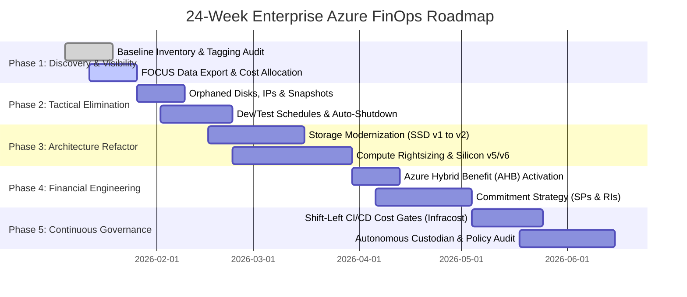

# 11. Enterprise FinOps Roadmap, Calendar & Milestones (24-Week Plan)

> 🧭 **Navigation**: [🏠 Framework Root](../README.md) | [📚 Documentation Index](README.md) | [⬅️ Previous: 10. Audit Playbook](10-audit-optimization-playbook-step-by-step.md) | [➡️ Next: 12. Legacy Results](12-legacy-architecture-governance-results.md)

## 1. Executive Summary & Phased Transformation Methodology

Sustainable cloud financial engineering in enterprise hybrid environments is not a one-time auditing exercise; it is an organizational and operational capability. This roadmap outlines a battle-tested **24-Week (6-Month) Phased Transformation Program** designed to systematically reduce Azure IaaS waste, modernize legacy workloads, implement automated governance, and establish a culture of cost accountability across distributed engineering teams.



---

## 2. 24-Week Detailed Phase Breakdown & Deliverables

### Phase 1: Discovery, Cost Allocation & Baseline (Weeks 1 – 2)

**Core Objective**: Achieve 100% visibility of all cloud assets, normalize billing streams using the FOCUS 1.0 schema, and enforce tagging hygiene.

- **Key Activities**:
  - Deploy FinOps Toolkit FOCUS Cost Management Exports to Azure Data Lake Storage (ADLS Gen2).
  - Execute automated discovery using Azure Resource Inventory (ARI) and AzGovViz.
  - Audit existing tags (`Environment`, `CostCenter`, `Owner`, `Workload`, `DisasterRecovery`).
  - Deploy Azure Policy guardrails in `Audit` mode to measure tagging compliance without disrupting CI/CD.
- **Exit Milestones**:
  - [x] Initial Unallocated Spend Baseline established (<15% unallocated cost).
  - [x] Complete inventory inventory report delivered to Cloud Center of Excellence (CCoE).
  - [x] Executive dashboard live in Power BI / Microsoft Fabric.

---

### Phase 2: Tactical Waste Elimination & Low-Hanging Fruit (Weeks 3 – 6)

**Core Objective**: Recoup immediate cash by pruning abandoned resources and stopping idle non-production environments.

- **Key Activities**:
  - Execute [`Cleanup-OrphanedDisks.ps1`](../automation/powershell/Cleanup-OrphanedDisks.ps1) with pre-deletion snapshot backups.
  - Release disassociated static Standard Public IPs and orphaned Network Interface Cards (NICs).
  - Enforce automated nightly deallocation (19:00 to 07:00 UTC) and weekend shutdowns for `env:dev`, `env:test`, and `env:sandbox` VMs using Azure Automation.
  - Consolidate and purge unattached disks older than 30 days.
- **Financial Target**:
  - Eliminate 10%–15% of gross monthly compute and storage spend.
  - **Projected Savings**: **$12,000 – $18,000 / month** (**€11,040 – €16,560 / month**) on a baseline 100-VM legacy estate.
- **Exit Milestones**:
  - [x] Zero unattached managed disks in active resource groups.
  - [x] Auto-shutdown active on 100% of non-production virtual machines.

---

### Phase 3: Architectural Rightsizing & Storage Modernization (Weeks 7 – 12)

**Core Objective**: Align provisioned capacity with actual workload utilization metrics and decouple storage performance from capacity.

- **Key Activities**:
  - Ingest 30 days of Azure Monitor compute telemetry (CPU P95 < 25%, Memory P95 < 35%).
  - Migrate legacy generation VMs (e.g., `Standard_D8s_v3`) to modern cost-optimized silicon:
    - Intel to AMD EPYC (`Standard_D8as_v5`): immediate **10% list price reduction**.
    - Linux workloads to ARM64 Ampere Altra (`Standard_D8ps_v5`): immediate **20% price-to-performance gain**.
  - Migrate fixed-tier `Premium SSD v1` disks (P30, 1024 GiB) to decoupled `Premium SSD v2`:
    - Provision exactly 250 GiB used storage, 3,000 IOPS, and 125 MB/s.
    - Achieves an **88.3% cost reduction** on provisioned storage without sacrificing performance.
- **Exit Milestones**:
  - [x] Average CPU utilization across active production fleet normalized to 65%–75%.
  - [x] Storage costs reduced by >40% across refactored virtual machines.

---

### Phase 4: Financial Engineering & Rate Optimization (Weeks 13 – 18)

**Core Objective**: Maximize enterprise discounts using Azure Hybrid Benefit (AHB), Reserved Instances (RIs), and Compute Savings Plans.

- **Key Activities**:
  - Execute license compliance audit for on-premises Windows Server and SQL Server with active Software Assurance (SA).
  - Activate AHB on eligible Windows Server and SQL Server VMs via zero-downtime metadata updates.
  - Model baseline compute demand using the provided [`finops_calculator.py`](../automation/python/finops_calculator.py):
    ```bash
    python3 automation/python/finops_calculator.py ahb \
      --vcpus 800 --edition Enterprise --currency BOTH
    ```
  - Purchase 3-Year Compute Savings Plans to cover 70%–80% of persistent baseline workloads (preserving flexibility across VM series and regions).
  - Purchase 3-Year Reserved Virtual Machine Instances for ultra-stable workloads (domain controllers, SAP HANA, core databases).
- **Financial Target**:
  - Up to **60%–72% discount** on baseline compute and software licensing.
  - **Projected Savings**: **$45,000 – $65,000 / month** (**€41,400 – €59,800 / month**).
- **Exit Milestones**:
  - [x] Commitment coverage ratio > 85% on production compute.
  - [x] Commitment utilization ratio maintained at > 95%.

---

### Phase 5: Continuous Governance & Shift-Left Culture (Weeks 19 – 24+)

**Core Objective**: Integrate cost controls into engineering pull requests and automate ongoing fleet hygiene.

- **Key Activities**:
  - Integrate Infracost into GitHub Actions, Azure DevOps, and GitLab CI/CD pipelines.
  - Enforce automated blocking on pull requests that exceed a **+$500 / +€460 monthly delta** without formal architecture approval.
  - Transition Azure Policy from `Audit` to `Deny` for unapproved oversized VM SKUs (e.g., M-series, E-series in non-DB subscriptions) and missing mandatory tags.
  - Deploy Cloud Custodian for autonomous waste pruning.
  - Conduct monthly cross-functional FinOps reviews between Finance, DevOps, and CCoE.
- **Exit Milestones**:
  - [x] 100% of Infrastructure as Code (IaC) changes inspected by pre-merge cost linting.
  - [x] Unit economic metrics (Cost per Transaction, Cost per Active User) tracked monthly.

---

## 3. Enterprise RACI Governance Matrix

| FinOps Capability / Task | Executive Leadership (CIO/CFO) | Cloud Center of Excellence (CCoE) | FinOps Practitioner | Lead Cloud Architect | DevOps / SRE Team | DBA Lead |
| :--- | :---: | :---: | :---: | :---: | :---: | :---: |
| **Strategy & Budget Allocation** | **A** | C | **R** | C | I | I |
| **Tagging Policy Definition** | I | **A** | **R** | C | C | I |
| **Orphaned Resource Cleanup** | I | C | **A** | I | **R** | C |
| **Compute Rightsizing Sign-off** | I | C | C | **A** | **R** | I |
| **SQL Storage / SKU Migration** | I | I | C | C | C | **A / R** |
| **AHB License Verification** | **A** | C | **R** | I | I | C |
| **Savings Plan & RI Purchases** | **A** | I | **R** | C | I | I |
| **Infracost CI/CD Gate Enforcement**| I | C | C | **A** | **R** | I |
| **Monthly Unit Economics Review** | **A** | C | **R** | C | C | C |

*Legend: **R** = Responsible, **A** = Accountable, **C** = Consulted, **I** = Informed.*

---

## 4. Day-0 to Day-180 Milestone Checklist

```text
[ ] DAY 0: Program Launch & Executive Sponsorship Secured
[ ] DAY 15: FOCUS 1.0 Cost Export Pipeline Operational in Azure Storage
[ ] DAY 30: Azure Governance Visualizer (AzGovViz) Architecture Snapshot Baselined
[ ] DAY 45: 100% of Unattached Disks, Orphaned IPs & Old Snapshots Remediated
[ ] DAY 60: Auto-Shutdown Enabled on All Non-Production Environments
[ ] DAY 90: Top 20 Costliest VMs Rightsized; Premium SSD v1-to-v2 Migration Wave 1 Completed
[ ] DAY 120: Azure Hybrid Benefit (AHB) Activated on Windows & SQL Fleets
[ ] DAY 150: 3-Year Compute Savings Plans & Reserved Instances Committed (>85% Coverage)
[ ] DAY 180: Infracost CI/CD Shift-Left Cost Gates Live across All Repositories
```

---

## 5. Quantitative Savings Velocity & ROI Curve

Based on an enterprise baseline estate of 100 legacy Azure IaaS virtual machines (compute, storage, networking, licensing) in West Europe and Spain Central:

```text
Cumulative Monthly Run Rate Over 24 Weeks:

Week 0 (Baseline):   $173,065 / month  (€159,220 / month)  [100.0%]
Week 4 (Tactical):   $156,200 / month  (€143,704 / month)  [-9.7%]
Week 8 (Rightsized): $132,450 / month  (€121,854 / month)  [-23.5%]
Week 12 (Storage v2):$114,800 / month  (€105,616 / month)  [-33.7%]
Week 18 (AHB + SPs): $48,200 / month   (€44,344 / month)   [-72.1%]
Week 24 (Optimized): $39,077 / month   (€35,951 / month)   [-77.4%]
```

The transformation achieves full financial breakeven within the first 6 weeks, yielding an ongoing annual recurring savings of **$1,607,856 / year** (**€1,479,228 / year**).

---

## 🧭 Navigation & Reading Path

| [⬅️ Previous: 10. Audit Playbook](10-audit-optimization-playbook-step-by-step.md) | [📚 Documentation Index](README.md) | [➡️ Next: 12. Legacy Results](12-legacy-architecture-governance-results.md) |
| :--- | :---: | ---: |
| [🏠 Return to Framework Root](../README.md) | **[Interactive Docs Directory](README.md)** | [Next Thematic Module ➡️](12-legacy-architecture-governance-results.md) |

