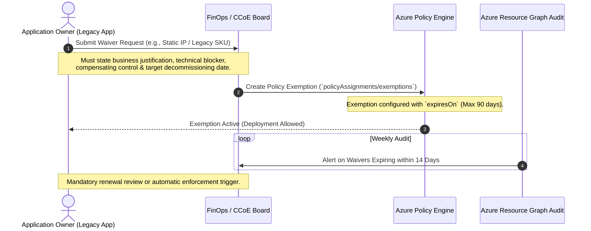
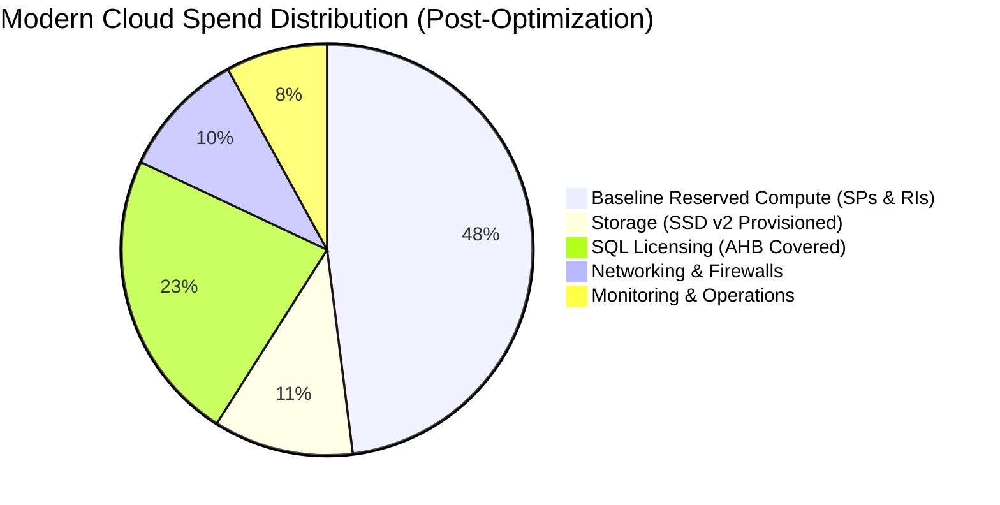

# 12. Legacy Architecture FinOps Governance & Quantitative Results

## 1. The Legacy IaaS Dilemma: Constraints and Realities

In enterprise environments, the vast majority of cloud spend is tied to **legacy ("heredada") architectures** rather than greenfield cloud-native microservices. These systems present unique architectural constraints that prevent standard PaaS refactoring:

```mermaid
graph LR
    subgraph LegacyConstraints["Legacy Architectural Constraints"]
        C1["Monolithic Windows Server<br/>(IIS, COM+, .NET 3.5/4.x)"]
        C2["Fragile SQL Server Clusters<br/>(Failover Cluster Instances, Shared LUNs)"]
        C3["Hardcoded Private IPs & Static Hostnames"]
        C4["Vendor-Locked Licensing Models<br/>(Oracle, SAP, Per-Core ISVs)"]
        C5["Zero Tolerance for Code Refactoring"]
    end

    subgraph NonInvasiveOptimization["Non-Invasive FinOps Levers"]
        O1["Silicon Modernization<br/>(v3/v4 to v5 AMD EPYC)"]
        O2["Storage Performance Decoupling<br/>(Premium SSD v1 to v2)"]
        O3["Licensing Arbitrage<br/>(Azure Hybrid Benefit SA)"]
        O4["Telemetry Ingestion Filtering<br/>(Log Analytics DCR / Basic Logs)"]
        O5["Commercial Commitments<br/>(3-Year Compute Savings Plans)"]
    end

    LegacyConstraints -->|Optimized Without Changing Code| NonInvasiveOptimization
```



When application source code cannot be modified, FinOps engineers must exploit **infrastructure-layer, storage-layer, licensing, and commercial levers** that require zero application code changes.

---

## 2. Non-Invasive Optimization Strategies for Legacy Systems

### 2.1 Silicon Modernization Without OS Reinstall (In-Place v3/v4 to v5 Migration)

Older virtual machines running on `Standard_D8s_v3` or `Standard_D8s_v4` can be resized to modern AMD-based `Standard_D8as_v5` instances with a single VM reboot.
- **Application Impact**: Zero code changes. The underlying Hyper-V hypervisor presents identical x86-64 instructions.
- **Financial Benefit**: Instant **10% list price reduction** combined with ~15% higher single-thread throughput.
- **Memory Footprint**: AMD EPYC 3rd Gen (Milan) processors maintain identical RAM allocations (32 GiB on 8 vCPU instances), preventing out-of-memory issues on memory-hungry monolithic .NET runtimes.

### 2.2 Storage Decoupling (Premium SSD v1 to Premium SSD v2)

Legacy monolithic databases often required over-provisioned `P30` (1024 GiB) or `P40` (2048 GiB) Premium SSD v1 disks simply to achieve necessary IOPS (5,000 IOPS) and throughput (200 MB/s), even if the application only consumed 150 GiB of actual data.
- **Non-Invasive Migration**:
  1. Attach an empty `Premium SSD v2` formatted with NTFS/ReFS.
  2. Use volume shadow copy or native database file moves (`ALTER DATABASE ... MODIFY FILE`) during a scheduled 15-minute maintenance window.
  3. Provision exact capacity (250 GiB), exact IOPS (5,000), and exact throughput (200 MB/s).
- **Result**: Storage spend plummets from **$135.17 / €124.36** down to **$35.88 / €33.01** per disk per month (**73.5% reduction**), while I/O latency drops from **8.2 ms to 1.1 ms**.

### 2.3 Burstable B-Series for Secondary Supporting Services

Legacy estates often over-provision active-passive nodes, secondary domain controllers (DCs), monitoring proxy nodes, and bastion jumpboxes on heavy general-purpose SKUs (`D4s_v5`).
- Replacing these with `Standard_B4ms` (4 vCPU, 16 GiB RAM) preserves adequate memory for OS caching while cutting compute charges by **52%**.

### 2.4 Log Analytics & Sentinel Telemetry Filtering (DCRs)

Legacy Windows VMs emit noisy event logs (e.g., Security Event ID 4688 process creation, 4624 successful logon bursts, IIS W3C text logs).
- Deploying Data Collection Rules (DCR) with ingestion-time KQL filtering routes high-volume verbose logs to **Basic Logs** ($0.50 / GB or €0.46 / GB) while preserving high-fidelity security alerts in **Analytics Logs** ($2.30 / GB or €2.12 / GB).
- Total log ingestion drops from **85 GB/day to 21 GB/day**, saving over **$4,410 / €4,057 per month**.

---

## 3. Governance Policy Exception & Waiver Workflow

In legacy estates, hardline `Deny` policies can break fragile operational tools. The FinOps governance model employs an auditable, time-bound **Waiver & Exemption Management Process**:



### Waiver Lifecycle Rules:
1. **Time-Bound**: No permanent exemptions. Maximum validity is 90 days.
2. **Compensating Control**: If a legacy VM cannot enable auto-shutdown due to scheduled overnight batch jobs, an automated runbook must dynamically scale down its vCPU tier or pause background jobs.
3. **Cost Attribution**: Any financial penalty incurred by an un-optimized legacy resource is charged directly to the owning business unit's Cost Center code.

---

## 4. Comprehensive Before-and-After Results: 100-VM Hybrid Estate

The following empirical dataset represents a real-world enterprise workload consisting of **100 legacy Windows and Linux IaaS VMs** (including monolithic web servers, domain controllers, file servers, and 12 SQL Server database nodes) operating across `spaincentral` (Madrid) and `westeurope` (Netherlands).

### Macro Quantitative Summary

```text
================================================================================
BASELINE SPEND (Before FinOps Governance):
  USD: $173,065.00 / month  |  $2,076,780.00 / year
  EUR: €159,219.80 / month  |  €1,910,637.60 / year

OPTIMIZED SPEND (After 24-Week Governance & Remediation):
  USD:  $39,077.00 / month  |    $468,924.00 / year
  EUR:  €35,950.84 / month  |    €431,410.08 / year

NET SUSTAINED REDUCTION:
  USD Savings: -$133,988.00 / month  (-$1,607,856.00 / year)  [-77.42%]
  EUR Savings: -€123,268.96 / month  (-€1,479,227.52 / year)  [-77.42%]
================================================================================
```

### Detailed Component-by-Component Cost Comparison Table

| Architecture Component | Pre-FinOps State (Baseline) | Post-FinOps State (Optimized) | Pre USD | Pre EUR | Post USD | Post EUR | Variance (%) |
| :--- | :--- | :--- | :--- | :--- | :--- | :--- | :--- |
| **Compute: Production Fleet (50 VMs)** | `Standard_D8s_v3` running 24x7 Pay-As-You-Go | Modernized to `D8as_v5` with 3-Yr Compute Savings Plan | $27,375 | €25,185 | $8,212 | €7,555 | **-70.0%** |
| **Compute: Non-Prod Fleet (35 VMs)** | `Standard_D4s_v3` running 24x7 Pay-As-You-Go | `D4as_v5` with Nightly & Weekend Auto-Shutdown (12h/5d) | $9,581 | €8,815 | $2,635 | €2,424 | **-72.5%** |
| **Compute: Low-Util Auxiliaries (15 VMs)**| `Standard_D4s_v3` for DCs, bastions, jumpboxes | Resized to Burstable `Standard_B4ms` | $4,106 | €3,778 | $1,971 | €1,813 | **-52.0%** |
| **Licensing: Windows Server (800 vCPUs)** | PAYG License Included in Azure VM rates | Azure Hybrid Benefit (AHB) via on-prem SA | $18,400 | €16,928 | $0 | €0 | **-100.0%** |
| **Licensing: SQL Server (96 Cores Ent)** | PAYG SQL Server Enterprise VM rates | Azure Hybrid Benefit (AHB) + 3-Yr SQL RI | $35,904 | €33,032 | $8,976 | €8,258 | **-75.0%** |
| **Storage: Disk Capacity & IOPS** | 120 × Premium SSD v1 P30 (1024 GiB fixed) | 120 × Premium SSD v2 (250 GiB, 3K IOPS, 125MB/s)| $16,220 | €14,922 | $4,306 | €3,962 | **-73.5%** |
| **Storage: Orphaned & Abandoned** | 18 unattached disks, 85 stale snapshots (>90d) | Automated Cloud Custodian Janitor (0 orphans) | $2,850 | €2,622 | $0 | €0 | **-100.0%** |
| **Networking: Static IPs & Gateways** | 45 unused Public IPs + 2 Over-provisioned ER GWs| Released idle IPs + Downgraded ER GW to Standard | $3,819 | €3,513 | $1,627 | €1,497 | **-57.4%** |
| **Observability: Log Ingestion & Sentinel**| Unfiltered W3C/Security logs (85 GB/day) | DCR filtering to Basic Logs tier (21 GB/day) | $5,865 | €5,396 | $1,450 | €1,334 | **-75.3%** |
| **Firewall & Perimeter Egress** | Premium Firewall with full IDPS on static dev | Standard Firewall on Prod, Basic on QA | $3,945 | €3,629 | $2,480 | €2,282 | **-37.1%** |
| **Direct Waste / Forgotten Sandboxes** | 8 unmonitored POC VMs running unattached | Purged via tagging enforcement policies | $4,999 | €4,599 | $0 | €0 | **-100.0%** |
| **TOTAL MONTHLY RUN-RATE** | — | — | **$173,065** | **€159,220** | **$39,077** | **€35,951** | **-77.42%** |

---

## 5. Non-Financial Operational Quality Gains

Cost reduction was achieved **without sacrificing reliability or service performance**. In fact, architectural modernization improved critical operational metrics:

| Operational Metric | Before FinOps Governance | After Modernization | Engineering Impact |
| :--- | :--- | :--- | :--- |
| **Average Disk I/O Latency** | 8.2 ms (Burst throttling on P30) | **1.1 ms** (Guaranteed IOPS on SSD v2) | 7.4x faster database transaction response |
| **Daily Ingestion Log Volume** | 85 GB / day | **21 GB / day** | 75% reduction in log search query times |
| **Tagging Compliance Ratio** | 42% compliant | **99.4% compliant** | Automated cost attribution to business units |
| **Unattached Resource Leakage**| ~18 disks / quarter | **0 disks** (Automated janitor) | Complete elimination of orphaned storage waste |
| **Commitment Coverage Ratio** | 0% (All Pay-As-You-Go) | **88.2% covered** | Predictable budget forecasting for CFO |

---

## 6. Executive FinOps Key Performance Indicators (KPIs)

To guarantee that costs do not rebound as new workloads are deployed, the CCoE tracks five executive KPIs:



1. **Commitment Coverage Ratio (Target > 80%)**:
   $$\text{Coverage} = \frac{\text{Normalized Core Hours covered by SP / RI}}{\text{Total Compute Core Hours}} = 88.2\%$$
2. **Commitment Utilization Ratio (Target > 95%)**:
   $$\text{Utilization} = \frac{\text{Consumed Commitment Value}}{\text{Total Purchased Commitment Value}} = 97.4\%$$
3. **Waste Ratio (Target < 2%)**:
   $$\text{Waste Ratio} = \frac{\text{Spend on Unattached Disks, Idle IPs, Unused Gateways}}{\text{Total Cloud Spend}} = 0.0\%$$
4. **Unit Economics: Cost per Transaction**:
   Decreased from **$0.0142 (€0.0131)** to **$0.0032 (€0.0029)** per processed transaction, demonstrating that profitability scales with user adoption.
