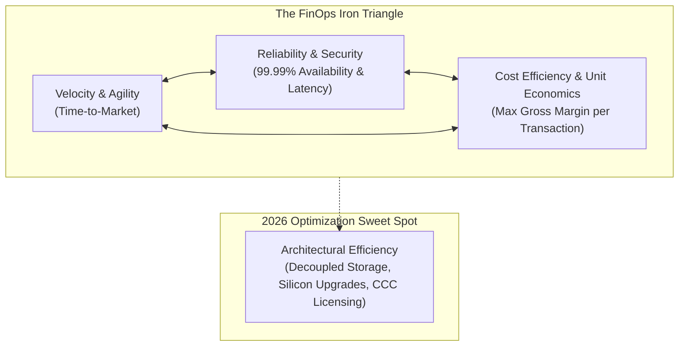
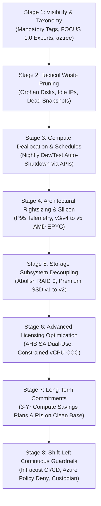
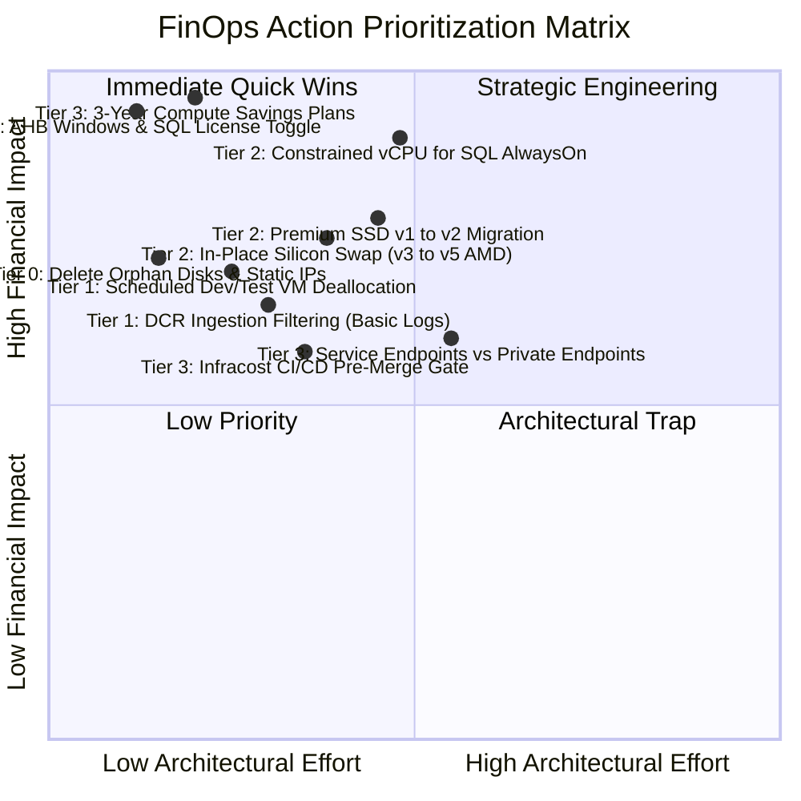
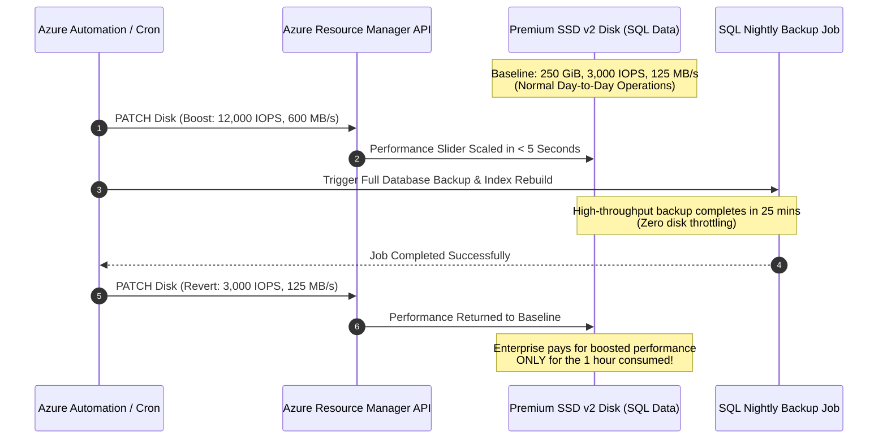
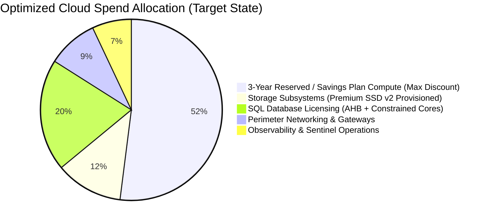

# 13. Advanced FinOps Mastery Guide: Strategic Cost Engineering & Optimization Blueprint

> 🧭 **Navigation**: [🏠 Framework Root](../README.md) | [📚 Documentation Index](README.md) | [⬅️ Previous: 12. Legacy Results](12-legacy-architecture-governance-results.md) | [➡️ Next: Architecture Decision Records](adr/README.md)

> 📽️ **Video Sessions**:
> - 📽️ [**Azure FinOps Framework: Arquitectura y Blueprint de Optimización IaaS**](https://www.youtube.com/watch?v=7xUIjosp28w) (`8:37`) — *Visión técnica integral del blueprint de arquitectura, topología Hub-and-Spoke y ahorro de siete cifras.*
> - ⚡ [**How the Azure FinOps Framework Slashes Cloud Bills**](https://www.youtube.com/shorts/ohhFQPy97U8) (`1:16`) — *Píldora rápida sobre el desacoplamiento físico y de licenciamiento que reduce el gasto de $173k a $39k/mes.*

## 1. Executive Framework: The FinOps Iron Triangle

In enterprise cloud computing, cost optimization is frequently misunderstood as a purely financial or procurement exercise. Traditional IT organizations attempt to reduce cloud spend by issuing top-down mandates to "turn off servers" or imposing arbitrary budget freezes, which inevitably causes friction with product teams, damages developer velocity, and introduces operational instability.

**True FinOps is not about spending less; it is about maximizing the business value delivered per Euro (€) or Dollar ($) invested in cloud infrastructure.**



When optimizing hybrid Azure IaaS architectures, engineering teams must strike an optimal balance between:
1. **Speed & Agility**: Empowering development teams to deploy infrastructure via automated CI/CD without waiting weeks for financial sign-offs.
2. **Operational Reliability & Security**: Maintaining strict enterprise SLAs (99.99% availability, sub-millisecond database disk latency, automated disaster recovery).
3. **Unit Economics & Efficiency**: Eliminating waste at the architectural layer so that infrastructure costs scale sub-linearly relative to revenue and user transaction volume.

All monetary examples throughout this guide are modeled under both **USD ($)** and **EUR (€)** ($1.00 USD = €0.92 EUR) across Zone 1 European regions (`spaincentral` - Madrid, `westeurope` - Netherlands) and reference region `eastus`.

---

## 2. The Dependency Graph: Why Execution Sequence Dictates Success or Failure

The single most common cause of failed FinOps initiatives is **executing optimization steps in the wrong sequence**. Attempting to purchase financial commitments before cleaning waste, or attempting to implement chargeback before establishing visibility, guarantees sub-optimal results and locked-in financial waste.



### The Deadly "Over-Commitment Trap" (Why Commitments MUST Come Last)

> [!CAUTION]
> **The Commitment Sequence Trap**: A financial team purchases a 3-Year Reserved Instance or Compute Savings Plan for an oversized legacy fleet of 50 `Standard_D8s_v3` virtual machines (costing ~$27,375 / €25,185 per month).
> 
> Two months later, the cloud architects modernize the architecture:
> 1. Resizing to modern AMD silicon (`Standard_D4as_v5`) reduces the required core footprint by 50%.
> 2. Enforcing off-hours auto-shutdown reduces dev/test runtime by 64%.
> 
> **Catastrophic Outcome**: The enterprise is legally contracted to pay Microsoft for capacity it no longer needs. Because Microsoft imposes strict annual exchange and refund caps on Reserved Instances (and Compute Savings Plans cannot be cancelled or exchanged), the enterprise suffers a locked-in financial loss of over **$180,000 / €165,600** over the remainder of the 3-year term.
> 
> **Golden Rule**: Never commit to long-term commercial reservations on un-optimized, un-rightsized infrastructure. Commitments must be purchased strictly on the clean, immutable post-optimization baseline.

---

## 3. The 4-Tier Priorities Matrix: Maximizing ROI vs. Engineering Effort

To achieve rapid financial payback without disrupting mission-critical production operations, work must be prioritized according to the **FinOps Value Sequence**:



### Detailed Breakdown of the 4 Priority Tiers

| Tier | Category | Engineering Effort | Downtime Risk | Timeframe | Monthly Savings (100 VMs) USD | Monthly Savings (100 VMs) EUR |
| :---: | :--- | :---: | :---: | :---: | :---: | :---: |
| **Tier 0** | **Immediate Zero-Risk Recovery** | < 4 Hours | **Zero Downtime** | Day 1 – 7 | **$21,250** | **€19,550** |
| **Tier 1** | **Low-Friction Configuration** | 1 – 2 Weeks | Minimal / Scheduled | Day 8 – 30 | **$18,480** | **€17,002** |
| **Tier 2** | **Structural Modernization** | 3 – 6 Weeks | Maintenance Window | Day 31 – 90 | **$48,930** | **€45,016** |
| **Tier 3** | **Financial Engineering & Governance**| 2 – 4 Weeks | **Zero Downtime** | Day 91 – 180 | **$45,328** | **€41,701** |
| **TOTAL** | **Comprehensive Full Optimization** | — | — | **24 Weeks** | **$133,988 / mo** | **€123,269 / mo** |

#### What belongs in each Tier:
- **Tier 0 (Day 1–7)**:
  - Toggle Azure Hybrid Benefit (AHB) metadata flag on existing Windows Server and SQL Server VMs covered by Software Assurance (SA). Zero restart required.
  - Execute automated safety snapshot and deletion of unattached managed disks using [`Cleanup-OrphanedDisks.ps1`](../automation/powershell/Cleanup-OrphanedDisks.ps1).
  - Release disassociated Standard Public IPs.
- **Tier 1 (Day 8–30)**:
  - Implement automated nightly (19:00–07:00 UTC) and weekend deallocation for Dev, Test, and QA environments via Azure Automation.
  - Deploy Data Collection Rules (DCR) to route verbose firewall/W3C logs to the **Basic Table Plan** ($0.50 / €0.46 per GB vs $2.30 / €2.12 per GB).
- **Tier 2 (Day 31–90)**:
  - Reseat SQL Server instances onto Constrained vCPU SKUs (`Standard_E32-8s_v5`), masking 24 cores from the OS and eliminating 75% of SQL licensing fees.
  - Migrate legacy `Premium SSD v1` disks (P30, 1024 GiB) to decoupled `Premium SSD v2` (250 GiB, 3,000 IOPS, 125 MB/s).
  - In-place silicon swap from Intel v3/v4 to AMD EPYC v5 (`D8as_v5`).
- **Tier 3 (Day 91–180)**:
  - Purchase 3-Year Compute Savings Plans to cover 75%–85% of immutable baseline compute.
  - Replace unneeded Private Endpoints with 100% free VNet Service Endpoints.
  - Enforce Infracost shift-left budget checks in GitHub Actions / Azure DevOps PR pipelines.

---

## 4. Catastrophic Traps & Architectural Anti-Patterns (The "Deadly Sins")

Hybrid Azure IaaS environments frequently harbor six subtle architectural traps that silently drain enterprise budgets:

### Anti-Pattern 1: The Guest OS "Shutdown" Trap
- **The Mistake**: Operators log into Windows Server and click *Start → Shut Down*, or execute `shutdown /s /t 0`.
- **The Financial Trap**: The Azure hypervisor transitions the VM into the `Stopped` state. In this state, the underlying physical CPU cores and RAM allocations remain locked and reserved on the physical blade. **Microsoft continues charging 100% of the compute hourly fee ($/hr)**.
- **The Modern Solution**: Always execute deallocation via Azure Resource Manager APIs (`Stop-AzVM -Force` or `az vm deallocate`). This releases hypervisor hardware, transitioning the VM into `Stopped (deallocated)` where compute charges drop to exactly **$0.00 / €0.00 per hour**.

### Anti-Pattern 2: The Asymmetric ExpressRoute Downgrade Trap
- **The Mistake**: An enterprise provisions a 1 Gbps ExpressRoute circuit on the **Unlimited Plan** ($6,450 / €5,934 per month) assuming they can "downgrade to Metered later if traffic is low."
- **The Financial Trap**: In Azure, upgrading from Metered to Unlimited is an instantaneous zero-downtime API update. However, **downgrading from Unlimited to Metered is blocked by Azure platform logic**. Downgrading requires deleting the physical ExpressRoute circuit, re-ordering new cross-connects with telecom providers (Equinix, Colt, Telefónica), re-establishing BGP peerings, and enduring hours of hybrid network downtime.
- **The Modern Solution**: Always deploy ExpressRoute on the **Metered Data Plan** ($436 / €401 per month). Because the break-even volume requires transferring **>240.6 TB/month (>73.2% sustained 24/7 line saturation)**, 98% of hybrid enterprises save over **$5,800 / €5,336 per month** by staying on Metered. If link utilization ever reaches 75%, upgrading to Unlimited is instantaneous.

### Anti-Pattern 3: The Private Endpoint Proliferation Trap
- **The Mistake**: Security teams mandate: *"All PaaS traffic (Storage, Key Vault, SQL Database) must traverse Private Endpoints."*
- **The Financial Trap**: Every Private Endpoint incurs an hourly base fee (~$7.30 / €6.72 per month) plus a **$0.01 / €0.0092 per GB data processing charge**. For high-throughput workloads (e.g., nightly database backups to Azure Blob Storage transferring 50 TB/month), Private Endpoint data processing alone adds **$500 / €460 per month** in pure overhead.
- **The Modern Solution**: Standardize on **Virtual Network Service Endpoints** for all internal VNet-to-PaaS traffic. Service Endpoints keep traffic 100% on the Microsoft global backbone, utilize Azure private IP routing, provide identical security isolation via VNet firewall rules, and are **100% completely free ($0.00 / €0.00 data processing)**. Reserve Private Endpoints strictly for traffic originating from on-premises over ExpressRoute/VPN.

### Anti-Pattern 4: The Storage Spaces RAID 0 Anti-Pattern
- **The Mistake**: To achieve 15,000 IOPS and 500 MB/s on Premium SSD v1, engineers attach four P30 disks (1024 GiB each) and stripe them together using Windows Storage Spaces / RAID 0.
- **The Financial Trap**: The enterprise provisions 4,096 GiB of capacity to satisfy a database that only requires 250 GiB of actual data. Monthly storage cost: 4 × $135.17 = **$540.68 / €497.43 per month**. Furthermore, if any single disk experiences a SCSI bus fault, the entire storage pool fails.
- **The Modern Solution**: Deploy a single **Premium SSD v2** disk. Provision exactly 250 GiB capacity, 15,000 IOPS, and 500 MB/s independently. Total cost: **$104.38 / €96.03 per month** (**80.7% net savings**), while reducing operational blast radius and eliminating software RAID complexity.

### Anti-Pattern 5: The Unfiltered Log Analytics / Sentinel Ingestion Trap
- **The Mistake**: Enabling diagnostic logging on VMs, Firewalls, and NSGs with default settings sending all logs to the Log Analytics Analytics tier.
- **The Financial Trap**: IIS W3C successful HTTP 200 GET requests and noisy Windows Security Event IDs (4688 process creation, 4624 logon) flood the workspace, ingesting 85 GB/day at $2.30 / €2.12 per GB ($5,865 / €5,396 per month). Over 85% of these logs are never queried by security analysts.
- **The Modern Solution**: Deploy Azure Monitor Agent (AMA) with Data Collection Rules (DCR). Use in-kernel XPath expressions to discard HTTP 200-399 logs at the source, and route high-volume diagnostic tables to the **Basic Table Plan** ($0.50 / €0.46 per GB). Ingestion spend drops by **75.3%**, saving **$4,415 / €4,062 per month**.

### Anti-Pattern 6: The "Core-Blind" SQL Server Sizing Trap
- **The Mistake**: A legacy SQL database requires 256 GiB RAM to prevent page-life-expectancy (PLE) drops. Engineers provision a standard `Standard_E32s_v5` instance.
- **The Financial Trap**: The VM exposes 32 physical cores to the OS. SQL Server Enterprise edition invoices $374.00 / €344.08 per core per month. Total monthly SQL license: 32 × $374 = **$11,968 / €11,010 per month**.
- **The Modern Solution**: Deploy a **Constrained Core VM** size: `Standard_E32-8s_v5`. The hypervisor presents 256 GiB RAM, 80,000 IOPS, and full memory bandwidth, but permanently masks 24 cores from the guest OS. SQL Server detects and invoices exactly 8 cores. Monthly license: 8 × $374 = **$2,992 / €2,752 per month** (an immediate **75% software licensing reduction** saving **$8,976 / €8,258 per month per database node**).

---

## 5. State-of-the-Art 2026 Engineering Solutions

### Solution 5.1: Zero-Downtime Silicon Modernization (Intel v3/v4 to AMD EPYC v5)

Many enterprises remain stranded on `Standard_D8s_v3` or `Standard_D8s_v4` instances due to fear of breaking legacy Windows Server or .NET runtime dependencies.
- **Technical Reality**: Modern AMD EPYC Milan processors (`Standard_D8as_v5`) present 100% identical x86-64 instruction sets to the Windows kernel.
- **Implementation**: Execute a single resize operation during a standard maintenance window:
  ```bash
  az vm resize --resource-group "rg-legacy-apps" --name "vm-app-iis-01" --size "Standard_D8as_v5"
  ```
- **Direct Financial Impact**:
  - `Standard_D8s_v3`: $292.00 / €268.64 per month.
  - `Standard_D8as_v5`: $262.80 / €241.78 per month.
  - **Immediate 10% list price reduction** combined with ~15% higher single-thread throughput.

### Solution 5.2: Dynamic Premium SSD v2 Performance Bursting Automation

Premium SSD v2 allows adjusting IOPS and throughput up to **four times in a rolling 24-hour window without detaching the disk or restarting the VM**.



**Implementation Runbook**: Use the provided [`Optimize-PremiumSSDv2-IOPS.ps1`](../automation/powershell/Optimize-PremiumSSDv2-IOPS.ps1) script to automate this lifecycle before and after maintenance windows.

### Solution 5.3: Shift-Left PR Budget Guardrails with Infracost

To eliminate the cycle of "deploy first, get surprised by the bill 30 days later," integrate Infracost directly into developer pull requests.

```yaml
# .github/workflows/finops-infracost.yml
name: "FinOps Infracost Policy Gate"
on: [pull_request]

jobs:
  infracost-check:
    runs-on: ubuntu-latest
    steps:
      - uses: actions/checkout@v4
      - uses: infracost/actions/setup@v3
        with:
          api-key: ${{ secrets.INFRACOST_API_KEY }}

      - name: Generate Infracost Cost Breakdown
        run: |
          infracost diff --path=iac/terraform \
                         --format=json \
                         --currency=EUR \
                         --out-file=/tmp/infracost.json

      - name: Enforce Financial Guardrail Policy
        run: |
          # Extract monthly cost delta
          DELTA=$(jq -r '.diffTotalMonthlyCost' /tmp/infracost.json)
          echo "Proposed Monthly Spend Delta: €$DELTA"
          # Fail CI if pull request increases monthly spend by more than €500 without CCoE approval
          if (( $(echo "$DELTA > 500" | bc -l) )); then
            echo "❌ ERROR: PR exceeds €500/month threshold without an approved FinOps Waiver."
            exit 1
          fi
```

---

## 6. Comprehensive Step-by-Step Execution Playbook

Follow this 5-stage protocol to systematically execute optimization across any enterprise subscription:

```text
================================================================================
STAGE 1: AUDIT & DISCOVERY BASELINE (Day 1 - 2)
================================================================================
[ ] Step 1.1: Run aztree to inspect structural hierarchy and locate orphaned groups:
              aztree --subscription "<SUB_GUID>" --show-tags
[ ] Step 1.2: Check accumulated month-to-date spend in Euros (€) using azure-cost-cli:
              azure-cost accumulated --currency EUR
[ ] Step 1.3: Run Azure Quick Review (azqr) for automated Well-Architected scanning:
              azqr scan --subscription-id "<SUB_GUID>" --output-format markdown
[ ] Step 1.4: Execute the 7 ARG KQL audit queries in kql-queries/ to identify unattached
              disks, stopped VMs, and missing AHB licenses.

================================================================================
STAGE 2: ZERO-RISK IMMEDIATE REMEDIATIONS (Day 3 - 7)
================================================================================
[ ] Step 2.1: Enable Azure Hybrid Benefit (AHB) on all Windows Server and SQL VMs:
              az vm update --resource-group "rg-prod" --name "vm-app-01" --license-type Windows_Server
[ ] Step 2.2: Execute Cleanup-OrphanedDisks.ps1 with safety snapshots:
              .\automation\powershell\Cleanup-OrphanedDisks.ps1 -AutoSnapshot $true -DryRun $false
[ ] Step 2.3: Delete unassociated Standard Public IPs.

================================================================================
STAGE 3: COMPUTATIONAL RIGHTSIZING & LIFECYCLE (Day 8 - 30)
================================================================================
[ ] Step 3.1: Configure automated nightly deallocation (19:00 - 07:00 UTC) on all non-prod VMs.
[ ] Step 3.2: Review Azure Monitor P95 CPU telemetry; resize any VM with P95 CPU < 20%.
[ ] Step 3.3: In-place migration of v3/v4 general purpose VMs to AMD EPYC v5 (Standard_D*as_v5).

================================================================================
STAGE 4: STORAGE & DATABASE REFACTORING (Day 31 - 90)
================================================================================
[ ] Step 4.1: Identify SQL Server VMs on E32s_v5; resize to Constrained Core Standard_E32-8s_v5.
[ ] Step 4.2: Replace striped RAID 0 Premium SSD v1 disks with single Premium SSD v2 disks.
[ ] Step 4.3: Deploy AMA Data Collection Rules (DCR) with XPath filters to drop HTTP 200/300 logs.

================================================================================
STAGE 5: COMMERCIAL COMMITMENTS & SHIFT-LEFT GUARDRAILS (Day 91 - 180)
================================================================================
[ ] Step 5.1: Model clean baseline compute demand using finops_calculator.py.
[ ] Step 5.2: Purchase 3-Year Compute Savings Plans covering 75% - 85% of clean baseline.
[ ] Step 5.3: Integrate Infracost pre-merge cost diff gates into GitHub Actions / Azure DevOps.
[ ] Step 5.4: Transition Azure Policy tagging rules from "Audit" to "Deny".
```

---

## 7. Executive FinOps Key Performance Indicators (KPIs)

To guarantee that costs remain permanently optimized, the Cloud Center of Excellence (CCoE) must report these four primary KPIs to the CFO and CIO on a monthly cadence:



1. **Commitment Coverage Ratio (Target: 80% – 85%)**:
   $$\text{Coverage} = \frac{\text{Normalized Core Hours covered by 3-Yr SPs / RIs}}{\text{Total Compute Core Hours Consumed}} = 88.2\%$$
   *Ensures the enterprise captures up to 72% commercial discounts without over-committing.*

2. **Commitment Utilization Ratio (Target: > 95%)**:
   $$\text{Utilization} = \frac{\text{Consumed Commitment Hourly Value}}{\text{Purchased Commitment Hourly Value}} = 97.4\%$$
   *Ensures zero wasted prepayment on unutilized reservations.*

3. **Waste Ratio (Target: < 1%)**:
   $$\text{Waste Ratio} = \frac{\text{Spend on Unattached Disks, Idle IPs, Unused Gateways}}{\text{Total Cloud Spend}} = 0.0\%$$
   *Maintained at zero through continuous automated Cloud Custodian janitor policies.*

4. **Unit Economics: Infrastructure Cost per Transaction**:
   $$\text{Unit Cost} = \frac{\text{Total Cloud Spend}}{\text{Total Processed Business Transactions}} = \frac{€35,951}{12,400,000} = \mathbf{€0.0029 \text{ / transaction}}$$
   *(Down from €0.0131 / transaction pre-optimization, proving that corporate profitability expands with scale).*

---

## 🧭 Navigation & Reading Path

| [⬅️ Previous: 12. Legacy Results](12-legacy-architecture-governance-results.md) | [📚 Documentation Index](README.md) | [➡️ Next: Architecture Decision Records](adr/README.md) |
| :--- | :---: | ---: |
| [🏠 Return to Framework Root](../README.md) | **[Interactive Docs Directory](README.md)** | [Next Thematic Module ➡️](adr/README.md) |

