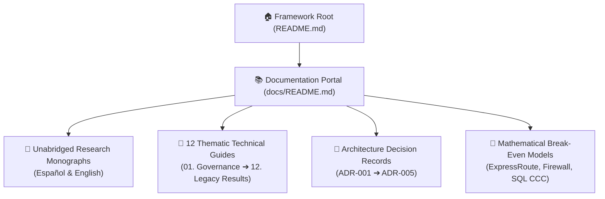

# 📚 Azure Hybrid IaaS FinOps Documentation Portal & Navigation Index

Welcome to the complete technical documentation suite for the **Azure Hybrid IaaS FinOps Framework**. This portal is designed to provide seamless bi-directional navigation across all architectural deep-dives, empirical research monographs, mathematical formulations, and operational playbooks.



---
---

## 🎥 Multimedia Video Sessions, Guides & Technical Shorts (15 Episodes)

All foundational pillars, mathematical models, and automation engines are accompanied by technical video episodes on YouTube ([**@nubenetes**](https://youtube.com/@nubenetes)):

| Engineering Pillar / Focus | Format | Video / Episode | Duration | Direct Link |
| :--- | :---: | :--- | :---: | :--- |
| **Comprehensive Architecture** | 🎙️ Podcast | [Podcast: Estrategias FinOps en Azure: Ahorro en Cómputo, SQL Server y Redes Híbridas](https://www.youtube.com/watch?v=Kt2MyQlUXew) | `21:24` | [▶️ Watch Podcast](https://www.youtube.com/watch?v=Kt2MyQlUXew) |
| **Global Architecture Blueprint** | 📽️ Video Guide | [Azure FinOps Framework: Enterprise Hybrid IaaS Architecture Blueprint](https://www.youtube.com/watch?v=7xUIjosp28w) | `8:37` | [▶️ Watch Video](https://www.youtube.com/watch?v=7xUIjosp28w) |
| **Global TCO Decoupling** | ⚡ Short | [How the Azure FinOps Framework Slashes Cloud Bills](https://www.youtube.com/shorts/ohhFQPy97U8) | `1:16` | [▶️ Watch Short](https://www.youtube.com/shorts/ohhFQPy97U8) |
| **Compute Rightsizing & Lifecycle** | 📽️ Video Guide | [Azure FinOps: 3D Compute Engineering, Rightsizing & VM Lifecycle Automation](https://www.youtube.com/watch?v=jt7t1BPNBsY) | `7:22` | [▶️ Watch Video](https://www.youtube.com/watch?v=jt7t1BPNBsY) |
| **The Deallocation Trap** | ⚡ Short | [The Azure Cloud VM Shutdown Trap: Stopped vs Deallocated](https://www.youtube.com/shorts/G49JolO2L2I) | `1:13` | [▶️ Watch Short](https://www.youtube.com/shorts/G49JolO2L2I) |
| **Database Licensing & CCC** | 📽️ Video Guide | [Azure Core Masking: Slash SQL Server Licensing Costs by 75% with FinOps](https://www.youtube.com/watch?v=vl6LKMgcKnw) | `8:35` | [▶️ Watch Video](https://www.youtube.com/watch?v=vl6LKMgcKnw) |
| **Constrained vCPU Strategy** | ⚡ Short | [How Core Masking Slashes Cloud Database Costs](https://www.youtube.com/shorts/EZQ6GnAEtpE) | `1:27` | [▶️ Watch Short](https://www.youtube.com/shorts/EZQ6GnAEtpE) |
| **Decoupled Storage Subsystem** | 📽️ Video Guide | [Azure Storage: Decouple Capacity & IOPS with Premium SSD v2 in FinOps](https://www.youtube.com/watch?v=BZsmqa_FUGk) | `8:43` | [▶️ Watch Video](https://www.youtube.com/watch?v=BZsmqa_FUGk) |
| **Storage Sliders & RAID 0** | ⚡ Short | [How Azure Premium SSD v2 Decouples Storage](https://www.youtube.com/shorts/FseN2K1O9PU) | `1:08` | [▶️ Watch Short](https://www.youtube.com/shorts/FseN2K1O9PU) |
| **Hybrid Network Economics** | 📽️ Video Guide | [Economía de Redes Híbridas en Azure: ExpressRoute, Firewall y Endpoints](https://www.youtube.com/watch?v=j9HNF-73zDQ) | `7:14` | [▶️ Watch Video](https://www.youtube.com/watch?v=j9HNF-73zDQ) |
| **ExpressRoute Break-Even** | ⚡ Short | [How Cloud Unlimited Plans Trap You](https://www.youtube.com/shorts/Xd2adpKN6VM) | `1:24` | [▶️ Watch Short](https://www.youtube.com/shorts/Xd2adpKN6VM) |
| **Observability Containment** | 📽️ Video Guide | [FinOps en Azure: Control de Costes en Telemetría, Logs y Monitorización](https://www.youtube.com/watch?v=jXgyXSNmXwM) | `5:33` | [▶️ Watch Video](https://www.youtube.com/watch?v=jXgyXSNmXwM) |
| **Edge XPath Filtering** | ⚡ Short | [How Edge Filtering Slashes Azure Log Costs](https://www.youtube.com/shorts/qzkXGfuQmT4) | `1:30` | [▶️ Watch Short](https://www.youtube.com/shorts/qzkXGfuQmT4) |
| **Governance & Automation** | 📽️ Video Guide | [FinOps Azure Híbrido: Gobernanza Coercitiva, Políticas y Automatización](https://www.youtube.com/watch?v=yAm1-z2ZpfA) | `6:42` | [▶️ Watch Video](https://www.youtube.com/watch?v=yAm1-z2ZpfA) |
| **Continuous Automation Engine** | ⚡ Short | [Turning Azure FinOps Theory into Automated Action](https://www.youtube.com/shorts/09oqxYUeHd8) | `1:19` | [▶️ Watch Short](https://www.youtube.com/shorts/09oqxYUeHd8) |


---

## 🗺️ Curated Reading Paths

Choose the reading path tailored to your organizational role:

```text
┌────────────────────────────────────────────────────────────────────────────────────────┐
│ 👔 Executive / Leadership (CIO, CFO, VP of Cloud)                                      │
│    1. Framework Root Summary (README.md)                                               │
│    2. docs/12-legacy-architecture-governance-results.md (77.4% ROI & Unit Economics)   │
│    3. docs/11-enterprise-roadmap-calendar-milestones.md (24-Week Calendar & RACI)      │
│    4. docs/04-commitment-portfolio-ri-savings-plans.md (Savings Plans & RIs)           │
├────────────────────────────────────────────────────────────────────────────────────────┤
│ 📊 FinOps Practitioner / Cloud Economist                                               │
│    1. docs/09-finops-tooling-ecosystem-2026.md (FinOps Toolkit, FOCUS, AZQR, CLI)      │
│    2. docs/10-audit-optimization-playbook-step-by-step.md (Automated Audit Playbook)   │
│    3. docs/math-models/ (ExpressRoute, Firewall Crossover, SQL CCC Matrices)           │
│    4. docs/01-governance-tagging-cost-allocation.md (Coercive Tagging & Allocation)   │
├────────────────────────────────────────────────────────────────────────────────────────┤
│ 🛠️ Cloud Architect, DevOps & SRE Lead                                                  │
│    1. docs/10-audit-optimization-playbook-step-by-step.md (Infracost, Steampipe, ARG)   │
│    2. docs/02-compute-rightsizing-lifecycle-spot.md (P95 Rightsizing & VMSS Spot)      │
│    3. docs/05-storage-optimization-premium-ssdv2.md (Decoupled Premium SSD v2)         │
│    4. docs/06-hybrid-network-expressroute-firewall-endpoints.md (Network Optimization)│
│    5. docs/07-observability-ama-dcr-log-analytics.md (AMA DCR Edge Log Filtering)      │
│    6. docs/adr/ (ADR-001 to ADR-005)                                                   │
├────────────────────────────────────────────────────────────────────────────────────────┤
│ 💾 Database Administrator (DBA) Lead                                                   │
│    1. docs/03-licensing-ahb-constrained-vcpu.md (Constrained vCPUs 75% SQL Reduction) │
│    2. docs/05-storage-optimization-premium-ssdv2.md (Independent IOPS/Throughput)     │
│    3. docs/adr/ADR-001-constrained-vcpu-for-sql-workloads.md                           │
│    4. docs/math-models/sql-licensing-ccc-matrix.md                                     │
└────────────────────────────────────────────────────────────────────────────────────────┘
```

---

## 📑 Complete Document Directory

### 1. 📖 Unabridged Research Monograph
Transcriptions of the foundational 19-page empirical research paper *"Informe Exhaustivo de Prácticas FinOps y Optimización de Costes para Arquitecturas Azure IaaS Híbridas"*:
- 🇪🇸 **[Informe Exhaustivo en Español (Texto Íntegro)](informe-exhaustivo-finops-azure-iaas-es.md)**: Versión completa original con todas las tablas, ecuaciones y 61 referencias bibliográficas.
- 🇬🇧 **[Comprehensive Report in English (Full Unabridged)](comprehensive-finops-azure-iaas-report-en.md)**: Academic-grade English translation maintaining strict structural concordance.

---

### 2. 🧱 Thematic Architectural Guides (Sequential 01 – 13)

| # | Guide Title | Primary Topic & Key Takeaway | Target Role |
| :-: | :--- | :--- | :--- |
| **01** | **[Governance, Tagging & Cost Allocation](01-governance-tagging-cost-allocation.md)** | Mandatory taxonomy, Azure Policy `Deny`/`Modify`, and Hub proportional chargeback. | CCoE / FinOps |
| **02** | **[Compute Rightsizing, Lifecycle & Spot](02-compute-rightsizing-lifecycle-spot.md)** | 30-day P95/P99 rightsizing, the guest OS shutdown trap, and VMSS Spot Priority Mix. | SRE / DevOps |
| **03** | **[Licensing, AHB & Constrained vCPUs](03-licensing-ahb-constrained-vcpu.md)** | Azure Hybrid Benefit (AHB), 180-day Dual-Use Rights, and `E32-8s_v5` core masking. | DBA / Finance |
| **04** | **[Commitment Portfolio (RIs & Savings Plans)](04-commitment-portfolio-ri-savings-plans.md)** | The "Floor & Ceiling" financial model: 3-Year RIs + Compute Savings Plans. | FinOps / CFO |
| **05** | **[Storage Optimization & Premium SSD v2](05-storage-optimization-premium-ssdv2.md)** | Abolishing RAID 0 striping; independent sliders for Capacity, IOPS, and MB/s. | Storage / DBA |
| **06** | **[Hybrid Networking: ExpressRoute & Firewall](06-hybrid-network-expressroute-firewall-endpoints.md)** | ExpressRoute break-even analysis, Firewall crossover point, and Service Endpoints. | Network Arch |
| **07** | **[Observability Containment: AMA & DCR](07-observability-ama-dcr-log-analytics.md)** | In-kernel XPath event filtering, Basic Table plan, dropping HTTP 200/300 logs. | SecOps / SRE |
| **08** | **[Anti-Patterns, Pitfalls & Gotchas](08-anti-patterns-and-gotchas.md)** | Catalog of the Top 15 architectural mistakes and hidden cost leaks in Azure IaaS. | All Engineers |
| **09** | **[Modern FinOps Tooling Ecosystem (2026)](09-finops-tooling-ecosystem-2026.md)** | FinOps Toolkit, AZQR, Azure Cost CLI, aztree, AOE, AzGovViz, Infracost, Steampipe. | FinOps / DevOps|
| **10** | **[Step-by-Step Audit & Remediation Playbook](10-audit-optimization-playbook-step-by-step.md)** | Discovery with ARI/ARG, waste cleanup, shift-left PR gates, and Eisenhower matrix. | Platform Eng |
| **11** | **[Enterprise Roadmap, Calendar & RACI](11-enterprise-roadmap-calendar-milestones.md)** | 24-week phased implementation plan, Day-0 to Day-180 milestones, and RACI matrix. | PMO / Director |
| **12** | **[Legacy Architecture Governance & Results](12-legacy-architecture-governance-results.md)** | Non-invasive optimization, Policy waivers, 77.4% before/after results table, KPIs. | CIO / Architect|
| **13** | **[Advanced FinOps Mastery Guide](13-advanced-finops-mastery-guide.md)** | The FinOps Iron Triangle, priority tiers, dependency graphs, 6 deadly sins, and 2026 solutions. | All Roles |

---

### 3. 📜 Architecture Decision Records (`docs/adr/`)
Immutable records of critical architectural and financial decisions:
- **[ADR-001: Constrained vCPU for SQL Workloads](adr/ADR-001-constrained-vcpu-for-sql-workloads.md)**
- **[ADR-002: Premium SSD v2 Decoupled Storage](adr/ADR-002-premium-ssd-v2-decoupled-storage.md)**
- **[ADR-003: ExpressRoute Metered vs. Unlimited Plan](adr/ADR-003-expressroute-metered-vs-unlimited.md)**
- **[ADR-004: Service Endpoints vs. Private Endpoints](adr/ADR-004-service-endpoints-vs-private-endpoints.md)**
- **[ADR-005: AMA with DCR Edge XPath Log Filtering](adr/ADR-005-ama-dcr-edge-log-filtering.md)**
- **[ADR Index & Decision Framework](adr/README.md)**

---

### 4. 📐 Mathematical Break-Even Models (`docs/math-models/`)
Formal algebraic proofs and crossover points in dual currency (**USD $** & **EUR €**):
- **[ExpressRoute Metered vs. Unlimited Break-Even](math-models/expressroute-breakeven.md)**: Proof of the 240.6 TB/month (73.2% 24/7 saturation) threshold.
- **[Azure Firewall SKU Crossover Analysis](math-models/firewall-sku-crossover.md)**: Formula proving the 12.74 TB/month crossover between Basic and Standard.
- **[SQL Server Constrained Core (CCC) Licensing Matrix](math-models/sql-licensing-ccc-matrix.md)**: Matrix calculating 50% to 75% software licensing savings.
- **[Math Models Directory & Index](math-models/README.md)**

---

## 🔗 Quick Resource Map

| Component | Code / Query Location | Associated Guide |
| :--- | :--- | :--- |
| **Dual-Engine IaC (Terraform)** | [`terraform/`](../terraform/) | [`01`](01-governance-tagging-cost-allocation.md), [`05`](05-storage-optimization-premium-ssdv2.md), [`06`](06-hybrid-network-expressroute-firewall-endpoints.md) |
| **Dual-Engine IaC (Bicep)** | [`bicep/`](../bicep/) | [`01`](01-governance-tagging-cost-allocation.md), [`05`](05-storage-optimization-premium-ssdv2.md), [`06`](06-hybrid-network-expressroute-firewall-endpoints.md) |
| **Azure Policies (JSON)** | [`policies/`](../policies/) | [`01-governance-tagging-cost-allocation.md`](01-governance-tagging-cost-allocation.md) |
| **ARG KQL Audit Pack** | [`kql-queries/`](../kql-queries/) | [`10-audit-optimization-playbook-step-by-step.md`](10-audit-optimization-playbook-step-by-step.md) |
| **Day-2 Runbooks (PowerShell)** | [`automation/powershell/`](../automation/powershell/) | [`02`](02-compute-rightsizing-lifecycle-spot.md), [`05`](05-storage-optimization-premium-ssdv2.md), [`10`](10-audit-optimization-playbook-step-by-step.md) |
| **Interactive FinOps CLI** | [`automation/python/finops_calculator.py`](../automation/python/finops_calculator.py) | [`math-models/`](math-models/README.md), [`03`](03-licensing-ahb-constrained-vcpu.md), [`06`](06-hybrid-network-expressroute-firewall-endpoints.md) |
