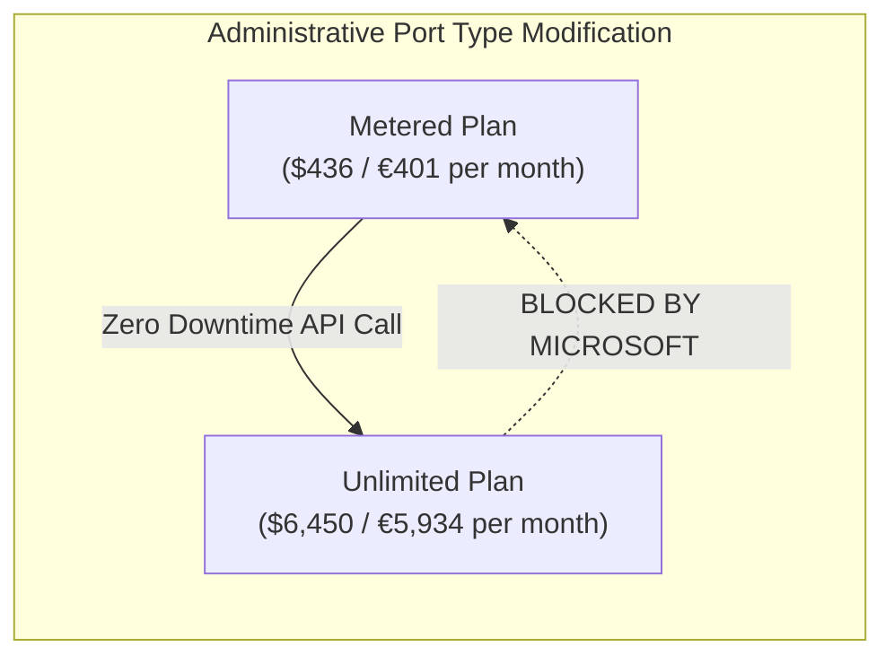

# Mathematical Model: Azure ExpressRoute Metered vs. Unlimited Break-Even Analysis

> 🧭 **Navigation**: [🏠 Framework Root](../../README.md) | [📚 Documentation Index](../README.md) | [📐 Math Models Index](README.md) | [➡️ Next: Firewall SKU Crossover](firewall-sku-crossover.md)

## 1. Executive Summary

Azure ExpressRoute connectivity provides two primary billing models for private peering circuits:
1. **Metered Data Plan**: Low fixed monthly port charge + variable per-GB outbound data transfer (egress) charge. Inbound data transfer (ingress) is free.
2. **Unlimited Data Plan**: High fixed monthly port charge covering unlimited outbound data transfer.

Due to migration fears of variable networking bills, enterprises frequently default to the **Unlimited Plan**. This mathematical model demonstrates that the Unlimited plan is only financially viable under extreme, sustained link saturation (>65-74% utilization 24/7/365), which virtually no standard hybrid IaaS deployment (Active Directory sync, RDP administration, SQL queries) ever reaches.

> 💶 **Dual-Currency Baseline (Europe & US)**:
> Modeled in both **USD ($)** and **EUR (€)** based on reference rates ($1.00 USD = €0.92 EUR) applicable to **Zone 1 regions** (including **Spain Central / Madrid**, **West Europe / Netherlands**, and **East US**).

---

## 2. Mathematical Formulation

### 2.1 Variables & Parameters

Let:
- $B$: Circuit Bandwidth capacity in Megabits per second ($\text{Mbps}$) or Gigabits per second ($\text{Gbps}$).
- $P_{\text{metered}}$: Fixed monthly port fee for Metered plan ($\text{USD / EUR per month}$).
- $P_{\text{unlimited}}$: Fixed monthly port fee for Unlimited plan ($\text{USD / EUR per month}$).
- $C_{\text{egress}}$: Egress cost per Gigabyte under the Metered plan ($\$0.025 \text{ USD} \approx €0.023 \text{ EUR / GB}$ in Zone 1).
- $E$: Total monthly egress data transfer in Gigabytes ($\text{GB/month}$).
- $T_{\text{month}}$: Number of hours in a billing month (standard: $730 \text{ hours} = 2,628,000 \text{ seconds}$).
- $E_{\text{max}}$: Theoretical maximum monthly egress data transfer at 100% continuous line saturation ($\text{GB/month}$).

### 2.2 Theoretical Maximum Throughput ($E_{\text{max}}$)

For a circuit with bandwidth capacity $B$ in $\text{Gbps}$:

$$E_{\text{max}} (\text{GB}) = \frac{B \times 10^9 \text{ bits/s}}{8 \text{ bits/byte} \times 10^9 \text{ bytes/GB}} \times 2,628,000 \text{ s} = B \times 328,500 \text{ GB}$$

- For a **1 Gbps** circuit: $E_{\text{max}} = 328,500 \text{ GB} \approx 328.5 \text{ TB/month}$.
- For a **10 Gbps** circuit: $E_{\text{max}} = 3,285,000 \text{ GB} \approx 3,285 \text{ TB/month}$.
- For a **100 Mbps** circuit ($0.1 \text{ Gbps}$): $E_{\text{max}} = 32,850 \text{ GB} \approx 32.85 \text{ TB/month}$.

### 2.3 Cost Functions

$$\text{Total Cost}_{\text{metered}}(E) = P_{\text{metered}} + (E \times C_{\text{egress}})$$

$$\text{Total Cost}_{\text{unlimited}} = P_{\text{unlimited}}$$

### 2.4 Break-Even Point ($E_{\text{break-even}}$)

$$\text{Total Cost}_{\text{metered}}(E_{\text{break-even}}) = \text{Total Cost}_{\text{unlimited}}$$

$$P_{\text{metered}} + (E_{\text{break-even}} \times C_{\text{egress}}) = P_{\text{unlimited}}$$

$$E_{\text{break-even}} = \frac{P_{\text{unlimited}} - P_{\text{metered}}}{C_{\text{egress}}}$$

$$U_{\text{break-even}} = \frac{E_{\text{break-even}}}{E_{\text{max}}} \times 100\%$$

---

## 3. Empirical Case Studies (Zone 1 - Spain Central, West Europe & US)

Reference conversion: $1.00 \text{ USD} = 0.92 \text{ EUR}$ ($C_{\text{egress}} = \$0.025 / \text{GB} \approx €0.023 / \text{GB}$).

| Circuit Bandwidth ($B$) | Metered Port ($P_{\text{metered}}$) | Unlimited Port ($P_{\text{unlimited}}$) | Egress Rate ($C_{\text{egress}}$) | Break-Even Volume ($E_{\text{break-even}}$) | Max Volume ($E_{\text{max}}$) | Break-Even Saturation ($U_{\text{break-even}}$) |
| :--- | :--- | :--- | :--- | :--- | :--- | :--- |
| **50 Mbps** | $55 / mo (**€50.60**) | $300 / mo (**€276.00**) | $0.025 / GB (€0.023) | **9,800 GB (9.8 TB)** | 16,425 GB | **59.66%** |
| **100 Mbps** | $105 / mo (**€96.60**) | $530 / mo (**€487.60**) | $0.025 / GB (€0.023) | **17,000 GB (17.0 TB)** | 32,850 GB | **51.75%** |
| **500 Mbps** | $275 / mo (**€253.00**) | $2,100 / mo (**€1,932.00**) | $0.025 / GB (€0.023) | **73,000 GB (73.0 TB)** | 164,250 GB | **44.44%** |
| **1 Gbps** | $436 / mo (**€401.12**) | $6,450 / mo (**€5,934.00**) | $0.025 / GB (€0.023) | **240,560 GB (240.6 TB)**| 328,500 GB | **73.23%** |
| **10 Gbps** | $2,180 / mo (**€2,005.60**) | $51,600 / mo (**€47,472.00**) | $0.025 / GB (€0.023) | **1,976,800 GB (1,977 TB)**| 3,285,000 GB | **60.18%** |

---

## 4. Architectural Analysis & The "One-Way Trap"

> [!CAUTION]
> **The Administrative Asymmetry Trap:**
> Azure permits in-place, zero-downtime upgrades from **Metered to Unlimited** via the Azure Portal, CLI, or ARM template.
> However, Azure **strictly forbids** in-place downgrades from **Unlimited to Metered**. To downgrade, you must delete the existing ExpressRoute circuit, break on-premises BGP peering, re-provision a new circuit with the telco carrier (a 3 to 8 week telecom lead time), and re-establish configuration.
> 
> **FinOps Cardinal Rule**: **ALWAYS deploy new ExpressRoute circuits on the Metered Data Plan.** Monitor egress bandwidth via Azure Monitor network metrics. Only switch to Unlimited if empirical egress exceeds the break-even threshold for 3 consecutive months.

---

## 🧭 Navigation

| [📐 Math Models Index](README.md) | [📐 Math Models Index](README.md) | [➡️ Next: Firewall SKU Crossover](firewall-sku-crossover.md) |
| :--- | :---: | ---: |
| [📚 Documentation Index](../README.md) | [🏠 Framework Root](../../README.md) | [Next Mathematical Model ➡️](firewall-sku-crossover.md) |

