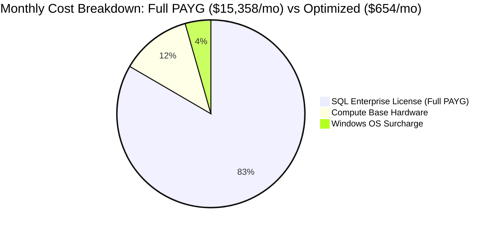

# Mathematical Model: SQL Server Licensing, Constrained vCPUs (CCC), and AHB Synergy

## 1. Executive Summary

SQL Server licensing in an enterprise IaaS model represents the single highest software cost multiplier. In Azure, SQL Server is billed **per active virtual core (vCPU)** exposed to the Guest Operating System:
- **SQL Server Enterprise**: $\approx \$0.5484$ per vCPU/hour ($\approx \$400.33$ per vCPU/month) under Pay-As-You-Go.
- **SQL Server Standard**: $\approx \$0.1465$ per vCPU/hour ($\approx \$106.95$ per vCPU/month) under Pay-As-You-Go.

Enterprise database workloads often experience the **"SQL Server Hardware Paradox"**: they require immense memory (RAM) and colossal disk I/O throughput (IOPS and bandwidth), but their transactional query concurrency only requires a fraction of the corresponding vCPU count.

Microsoft addresses this via **Constrained vCPU virtual machine sizes** (e.g., `Standard_E32-8s_v5`). This mathematical model analyzes the financial dynamics of Constrained Cores combined with **Azure Hybrid Benefit (AHB)** and **3-Year Reserved Instances (RIs)**.

---

## 2. Mathematical Formulation

### 2.1 The Cost Architecture of a SQL Server IaaS VM

The total monthly cost of a SQL Server VM in Azure is the sum of three distinct billing components:

$$\text{Cost}_{\text{Total}} = \text{Cost}_{\text{Compute Base}} + \text{Cost}_{\text{Windows OS}} + \text{Cost}_{\text{SQL License}}$$

Where:
- $\text{Cost}_{\text{Compute Base}}$: The physical infrastructure cost (RAM, CPU silicon, NVMe, host bandwidth). Billed based on the **full underlying hardware size** ($N_{\text{phys}}$).
- $\text{Cost}_{\text{Windows OS}}$: The Windows Server license fee ($N_{\text{phys}}$ cores). When **Azure Hybrid Benefit (AHB) for Windows Server** is enabled:
  $$\text{Cost}_{\text{Windows OS}} = \$0.00$$
- $\text{Cost}_{\text{SQL License}}$: The database engine software fee. Billed **ONLY on the active vCPUs** exposed to the Guest OS ($N_{\text{active}}$):
  $$\text{Cost}_{\text{SQL License}} = N_{\text{active}} \times R_{\text{SQL}}$$

When **Azure Hybrid Benefit (AHB) for SQL Server** is enabled using existing licenses with Software Assurance (SA):
$$\text{Cost}_{\text{SQL License}} = \$0.00$$

### 2.2 Constrained Core Ratios and Licensing Reduction

Let:
- $N_{\text{phys}}$: Total physical cores of the base VM SKU (e.g. 32 cores on `Standard_E32s_v5`).
- $N_{\text{active}}$: Active vCPUs configured via Constrained Cores (e.g. 8 cores on `Standard_E32-8s_v5`).
- $R_{\text{savings}}$: Percentage reduction in SQL Server licensing fees:

$$R_{\text{savings}} = \left( 1 - \frac{N_{\text{active}}}{N_{\text{phys}}} \right) \times 100\%$$

For `Standard_E32-8s_v5`:
$$R_{\text{savings}} = \left( 1 - \frac{8}{32} \right) \times 100\% = 75\% \text{ reduction}$$

---

## 3. Financial Comparison Matrix (E32 Family - 256 GiB RAM, 80,000 IOPS)

Assumptions: East US / West Europe, 730 hours/month. Base Compute `Standard_E32s_v5` $\approx \$1,868.80/\text{mo}$. SQL Enterprise PAYG rate $\approx \$400.33/\text{core/mo}$.

| Configuration | Base Compute | Active Cores | SQL Enterprise License | Windows OS | Total Monthly | Annual TCO | Net Savings |
| :--- | :--- | :--- | :--- | :--- | :--- | :--- | :--- |
| **Unconstrained E32s_v5 (Full PAYG)** | $1,868.80 | 32 | $12,810.56 | $678.90 | **$15,358.26** | **$184,299.12** | Baseline |
| **Constrained E32-16s_v5 (PAYG SQL)** | $1,868.80 | 16 | $6,405.28 | $678.90 | **$8,952.98** | **$107,435.76** | **41.7% ($76,863/yr)** |
| **Constrained E32-8s_v5 (PAYG SQL)** | $1,868.80 | 8 | $3,202.64 | $678.90 | **$5,750.34** | **$69,004.08** | **62.6% ($115,295/yr)** |
| **Constrained E32-8s_v5 + Windows AHB** | $1,868.80 | 8 | $3,202.64 | $0.00 | **$5,071.44** | **$60,857.28** | **67.0% ($123,442/yr)** |
| **E32-8s_v5 + Win AHB + SQL AHB** | $1,868.80 | 8 | $0.00 (SA) | $0.00 | **$1,868.80** | **$22,425.60** | **87.8% ($161,873/yr)** |
| **E32-8s_v5 + Win AHB + SQL AHB + 3-Yr RI** | $654.08 | 8 | $0.00 (SA) | $0.00 | **$654.08** | **$7,848.96** | **95.7% ($176,450/yr)** |

---

## 4. Architectural & Operational Considerations

1. **NUMA Boundary and Thread Contention Protection**:
   SQL Server performance degrades when thread scheduler contention spikes across wide multi-socket NUMA boundaries. Limiting active vCPUs to 8 or 16 within a single NUMA node prevents diagnostic latch contention errors and minimizes context switching.
2. **Memory and I/O Bandwidth Preservation**:
   Although active vCPUs are constrained to 8, the operating system retains the full **256 GiB of RAM**, **80,000 IOPS**, and **1,200 MB/s disk throughput**. The database buffer pool can cache large table partitions without experiencing memory pressure.
3. **Resizing Caveat**:
   If a team scales a VM from `E4ads_v5` to `E8ads_v5` without specifying a constrained SKU, Azure instantly doubles the per-second SQL license billing. Always enforce constrained VM naming conventions via **Azure Policy**.
